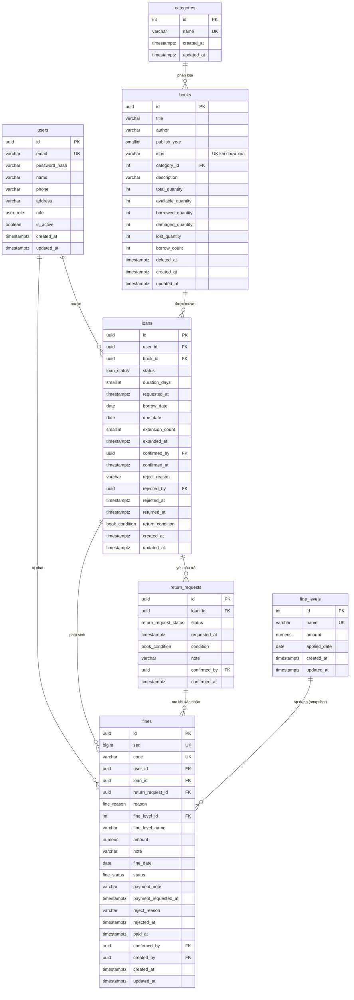
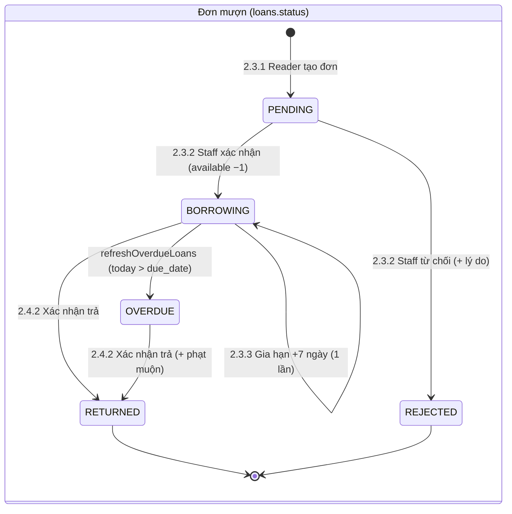
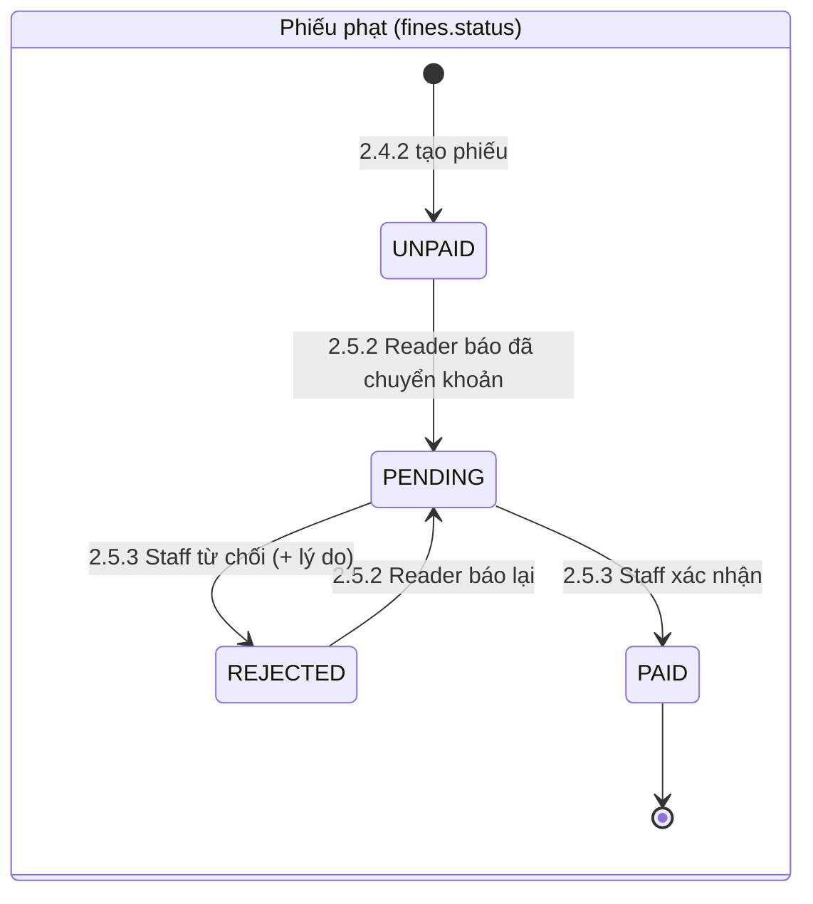

# Thiết kế cơ sở dữ liệu

PostgreSQL trên Supabase, schema `public`. Migration viết bằng SQL thuần, chạy qua Supabase MCP `apply_migration`, lưu tại `backend/sql/NNN_<tên>.sql`, sau đó `prisma db pull` → `prisma generate`. **Không** dùng `prisma migrate`.

Quy ước: tên bảng/cột `snake_case` số nhiều; khóa chính `uuid` (`gen_random_uuid()`) cho dữ liệu nghiệp vụ, `integer identity` cho bảng danh mục nhỏ (`categories`, `fine_levels`); thời điểm `timestamptz` (UTC); "ngày" nghiệp vụ dùng `date` theo giờ Asia/Ho_Chi_Minh; tiền `numeric(12,0)` (VND).

## 1. ERD

## 2. Enum

| Enum | Giá trị | Hiển thị (VI) | Dùng ở |
|------|---------|---------------|--------|
| `user_role` | `READER`, `LIBRARIAN`, `ADMIN` | Độc giả, Nhân viên, Quản lý viên | `users.role` |
| `loan_status` | `PENDING`, `BORROWING`, `OVERDUE`, `RETURNED`, `REJECTED` | Chờ xác nhận, Đang mượn, Quá hạn, Đã trả, Bị từ chối | `loans.status` |
| `return_request_status` | `PENDING`, `CONFIRMED` | Chờ xác nhận, Đã xác nhận | `return_requests.status` |
| `book_condition` | `NORMAL`, `DAMAGED`, `LOST` | Bình thường, Hư hỏng, Mất | `return_requests.condition`, `loans.return_condition` |
| `fine_reason` | `LATE`, `DAMAGED`, `LOST` | Trả muộn, Hư hỏng, Mất sách | `fines.reason` |
| `fine_status` | `UNPAID`, `PENDING`, `REJECTED`, `PAID` | Chưa thanh toán, Chờ xác nhận, Từ chối, Đã thanh toán | `fines.status` |

Trạng thái sách ("Có sẵn" / "Hết sách") **không** lưu, suy ra từ `available_quantity > 0`.

### Máy trạng thái

Yêu cầu trả: `PENDING → CONFIRMED` (2.4.1 → 2.4.2).

## 3. Mô tả bảng

### 3.1 `users`
| Cột | Kiểu | Ràng buộc | Ghi chú |
|-----|------|-----------|---------|
| `id` | `uuid` | PK, default `gen_random_uuid()` | |
| `email` | `varchar(255)` | NOT NULL, `CHECK (email = lower(email))`, UNIQUE | Lưu lowercase |
| `password_hash` | `varchar(255)` | NOT NULL | bcrypt |
| `name` | `varchar(50)` | NOT NULL, `CHECK (length(trim(name)) > 0)` | |
| `phone` | `varchar(15)` | NULL | Bắt buộc khi cập nhật hồ sơ (app) |
| `address` | `varchar(255)` | NULL | Bắt buộc khi cập nhật hồ sơ (app) |
| `role` | `user_role` | NOT NULL, default `'READER'` | |
| `is_active` | `boolean` | NOT NULL, default `true` | |
| `created_at` | `timestamptz` | NOT NULL, default `now()` | "Ngày tham gia" |
| `updated_at` | `timestamptz` | NOT NULL, default `now()` | trigger `set_updated_at` |

### 3.2 `categories`
| Cột | Kiểu | Ràng buộc | Ghi chú |
|-----|------|-----------|---------|
| `id` | `integer` | PK, `GENERATED ALWAYS AS IDENTITY` | |
| `name` | `varchar(50)` | NOT NULL, `CHECK (length(trim(name)) > 0)` | UNIQUE `lower(name)` |
| `created_at`, `updated_at` | `timestamptz` | NOT NULL, default `now()` | |

### 3.3 `books`
| Cột | Kiểu | Ràng buộc | Ghi chú |
|-----|------|-----------|---------|
| `id` | `uuid` | PK | |
| `title` | `varchar(100)` | NOT NULL | |
| `author` | `varchar(100)` | NOT NULL | |
| `publish_year` | `smallint` | NOT NULL, `CHECK (publish_year >= 1900)` | Cận trên (năm hiện tại) kiểm tra ở Joi |
| `isbn` | `varchar(13)` | NULL, `CHECK (isbn ~ '^(\d{9}[\dX]|\d{13})$')` | Đã chuẩn hóa; checksum kiểm tra ở app |
| `category_id` | `integer` | NULL, FK → `categories(id)` `ON DELETE SET NULL` | NULL chỉ xảy ra với sách đã xóa mềm (xem R-03) |
| `description` | `varchar(255)` | NOT NULL | |
| `total_quantity` | `integer` | NOT NULL, `CHECK (total_quantity > 0)` | |
| `available_quantity` | `integer` | NOT NULL, default 0, `CHECK (>= 0)` | |
| `borrowed_quantity` | `integer` | NOT NULL, default 0, `CHECK (>= 0)` | |
| `damaged_quantity` | `integer` | NOT NULL, default 0, `CHECK (>= 0)` | |
| `lost_quantity` | `integer` | NOT NULL, default 0, `CHECK (>= 0)` | |
| `borrow_count` | `integer` | NOT NULL, default 0, `CHECK (>= 0)` | Lượt mượn (sort "Phổ biến") |
| `deleted_at` | `timestamptz` | NULL | Xóa mềm |
| `created_at`, `updated_at` | `timestamptz` | NOT NULL | |

Ràng buộc bảng: `CHECK (total_quantity = available_quantity + borrowed_quantity + damaged_quantity + lost_quantity)` — `chk_books_quantity_balance`.

### 3.4 `loans`
| Cột | Kiểu | Ràng buộc | Ghi chú |
|-----|------|-----------|---------|
| `id` | `uuid` | PK | |
| `user_id` | `uuid` | NOT NULL, FK → `users` `ON DELETE RESTRICT` | Độc giả |
| `book_id` | `uuid` | NOT NULL, FK → `books` `ON DELETE RESTRICT` | |
| `status` | `loan_status` | NOT NULL, default `'PENDING'` | |
| `duration_days` | `smallint` | NOT NULL, default 14, `CHECK (duration_days BETWEEN 1 AND 30)` | |
| `requested_at` | `timestamptz` | NOT NULL, default `now()` | "Đơn mượn hôm nay" |
| `borrow_date` | `date` | NULL | Đặt khi xác nhận |
| `due_date` | `date` | NULL | `borrow_date + duration_days (+7 nếu gia hạn)` |
| `extension_count` | `smallint` | NOT NULL, default 0, `CHECK (extension_count BETWEEN 0 AND 1)` | |
| `extended_at` | `timestamptz` | NULL | |
| `confirmed_by` | `uuid` | NULL, FK → `users` | |
| `confirmed_at` | `timestamptz` | NULL | |
| `reject_reason` | `varchar(255)` | NULL | |
| `rejected_by` | `uuid` | NULL, FK → `users` | |
| `rejected_at` | `timestamptz` | NULL | |
| `returned_at` | `timestamptz` | NULL | |
| `return_condition` | `book_condition` | NULL | |
| `created_at`, `updated_at` | `timestamptz` | NOT NULL | |

Ràng buộc bảng:
- `chk_loans_dates`: `status IN ('PENDING','REJECTED') OR (borrow_date IS NOT NULL AND due_date IS NOT NULL)`
- `chk_loans_rejected`: `status <> 'REJECTED' OR reject_reason IS NOT NULL`
- `chk_loans_returned`: `status <> 'RETURNED' OR (returned_at IS NOT NULL AND return_condition IS NOT NULL)`

### 3.5 `return_requests`
| Cột | Kiểu | Ràng buộc | Ghi chú |
|-----|------|-----------|---------|
| `id` | `uuid` | PK | |
| `loan_id` | `uuid` | NOT NULL, FK → `loans` `ON DELETE RESTRICT` | |
| `status` | `return_request_status` | NOT NULL, default `'PENDING'` | |
| `requested_at` | `timestamptz` | NOT NULL, default `now()` | |
| `condition` | `book_condition` | NULL | Đặt khi xác nhận |
| `note` | `varchar(500)` | NULL | |
| `confirmed_by` | `uuid` | NULL, FK → `users` | |
| `confirmed_at` | `timestamptz` | NULL | |

Ràng buộc: `chk_rr_confirmed`: `status <> 'CONFIRMED' OR (condition IS NOT NULL AND confirmed_at IS NOT NULL)`; `chk_rr_note`: `condition NOT IN ('DAMAGED','LOST') OR note IS NOT NULL`.

### 3.6 `fine_levels`
| Cột | Kiểu | Ràng buộc | Ghi chú |
|-----|------|-----------|---------|
| `id` | `integer` | PK, identity | |
| `name` | `varchar(25)` | NOT NULL | UNIQUE `lower(name)` |
| `amount` | `numeric(12,0)` | NOT NULL, `CHECK (amount > 0)` | |
| `applied_date` | `date` | NOT NULL, default `(now() AT TIME ZONE 'Asia/Ho_Chi_Minh')::date` | "Ngày phạt" trong PRD |
| `created_at`, `updated_at` | `timestamptz` | NOT NULL | |

### 3.7 `fines`
| Cột | Kiểu | Ràng buộc | Ghi chú |
|-----|------|-----------|---------|
| `id` | `uuid` | PK | |
| `seq` | `bigint` | `GENERATED ALWAYS AS IDENTITY`, UNIQUE | Nguồn cho mã phiếu |
| `code` | `varchar(10)` | `GENERATED ALWAYS AS ('F' \|\| lpad(seq::text, 6, '0')) STORED`, UNIQUE | Nội dung chuyển khoản `PHAT F000123` |
| `user_id` | `uuid` | NOT NULL, FK → `users` `ON DELETE RESTRICT` | Độc giả bị phạt |
| `loan_id` | `uuid` | NOT NULL, FK → `loans` `ON DELETE RESTRICT` | |
| `return_request_id` | `uuid` | NOT NULL, FK → `return_requests` | |
| `reason` | `fine_reason` | NOT NULL | |
| `fine_level_id` | `integer` | NULL, FK → `fine_levels` `ON DELETE SET NULL` | |
| `fine_level_name` | `varchar(25)` | NOT NULL | Snapshot |
| `amount` | `numeric(12,0)` | NOT NULL, `CHECK (amount > 0)` | Snapshot |
| `note` | `varchar(500)` | NULL | |
| `fine_date` | `date` | NOT NULL | "Ngày phạt" của phiếu |
| `status` | `fine_status` | NOT NULL, default `'UNPAID'` | |
| `payment_note` | `varchar(255)` | NULL | Mã giao dịch reader nhập |
| `payment_requested_at` | `timestamptz` | NULL | |
| `reject_reason` | `varchar(255)` | NULL | |
| `rejected_at` | `timestamptz` | NULL | |
| `paid_at` | `timestamptz` | NULL | Doanh thu phạt tính theo cột này |
| `confirmed_by` | `uuid` | NULL, FK → `users` | Staff xác nhận/từ chối |
| `created_by` | `uuid` | NOT NULL, FK → `users` | Staff xác nhận trả |
| `created_at`, `updated_at` | `timestamptz` | NOT NULL | |

Ràng buộc: `uq_fines_loan_reason UNIQUE (loan_id, reason)`; `chk_fines_paid`: `status <> 'PAID' OR paid_at IS NOT NULL`; `chk_fines_rejected`: `status <> 'REJECTED' OR reject_reason IS NOT NULL`.

## 4. Index

| Bảng | Index | Phục vụ |
|------|-------|---------|
| `users` | `UNIQUE (email)` — tương đương `lower(email)` nhờ CHECK lowercase; dùng ràng buộc thường để Prisma nhận diện (`findUnique`) | Đăng nhập, chống trùng (2.1.1, 2.1.2) |
| `users` | `(role, is_active)` | Lọc người dùng (2.6.1), dashboard |
| `users` | GIN `pg_trgm` trên `name`, `email` | Tìm kiếm ILIKE (2.6.1) |
| `categories` | `UNIQUE (lower(name))` | Chống trùng (2.2.1) |
| `books` | `UNIQUE (isbn) WHERE deleted_at IS NULL AND isbn IS NOT NULL` | ISBN duy nhất (2.2.2) |
| `books` | `(category_id) WHERE deleted_at IS NULL` | Lọc theo thể loại, kiểm tra xóa thể loại |
| `books` | GIN `pg_trgm` trên `title`, `author` | Tìm kiếm (2.2.3) |
| `books` | `(borrow_count DESC) WHERE deleted_at IS NULL` | Sort phổ biến, Top 5 |
| `loans` | `(user_id, status)` | Giới hạn 5 cuốn, lịch sử (2.3.1, 2.3.3) |
| `loans` | `(book_id, status)` | Kiểm tra xóa sách, lịch sử sách (2.2.4, 2.2.5) |
| `loans` | `(status, due_date)` | `refreshOverdueLoans`, dashboard |
| `loans` | `UNIQUE (user_id, book_id) WHERE status IN ('PENDING','BORROWING','OVERDUE')` | Chống mượn trùng (2.3.1 BR-04) |
| `loans` | `(requested_at)`, `(borrow_date)`, `(returned_at)` | Dashboard, báo cáo mượn trả |
| `return_requests` | `UNIQUE (loan_id) WHERE status = 'PENDING'` | 1 yêu cầu trả chờ / đơn (2.4.1) |
| `return_requests` | `(status, requested_at)` | Tab "Chờ xác nhận trả" |
| `return_requests` | `(confirmed_at) WHERE condition IN ('DAMAGED','LOST')` | Báo cáo mất/hư |
| `fine_levels` | `UNIQUE (lower(name))` | Chống trùng (2.5.1) |
| `fines` | `(user_id, status)` | Chặn mượn khi nợ phạt, trang phạt reader |
| `fines` | `(status, created_at)` | Danh sách Staff |
| `fines` | `(paid_at) WHERE status = 'PAID'` | Báo cáo doanh thu |
| FK khác | `loans.confirmed_by`, `loans.rejected_by`, `return_requests.confirmed_by`, `fines.loan_id`, `fines.return_request_id`, `fines.fine_level_id`, `fines.confirmed_by`, `fines.created_by` | Tránh cảnh báo "unindexed foreign key" của Supabase advisor |

Partial index và expression index không biểu diễn được đầy đủ trong `schema.prisma` → chỉ tồn tại trong SQL migration (đó là lý do không dùng `prisma migrate`).

## 5. Quy tắc toàn vẹn dữ liệu

| Mã | Quy tắc | Cơ chế | Luồng |
|----|---------|--------|-------|
| R-01 | Email duy nhất, lowercase | UNIQUE `email` + CHECK `email = lower(email)` | 2.1.1 |
| R-02 | Bất biến số lượng: `total = available + borrowed + damaged + lost`, mọi bộ đếm ≥ 0 | CHECK `chk_books_quantity_balance` | 2.2.2, 2.2.5, 2.3.2, 2.4.2 |
| R-03 | Chỉ xóa thể loại khi không còn sách chưa xóa | App kiểm tra + trigger `trg_categories_block_delete` (BEFORE DELETE, raise nếu tồn tại `books` có `category_id = OLD.id AND deleted_at IS NULL`); sách đã xóa mềm → `category_id` SET NULL | 2.2.1 |
| R-04 | Chỉ xóa (mềm) sách khi không có đơn `PENDING/BORROWING/OVERDUE` | App kiểm tra trong transaction (`FOR UPDATE` dòng sách) | 2.2.5 |
| R-05 | Số lượng chỉ giảm khi Staff **xác nhận** đơn mượn | Chỉ service `confirmLoan` cập nhật `available/borrowed` | 2.3.1, 2.3.2 |
| R-06 | Giới hạn 5 đơn hoạt động / reader | App, transaction + `SELECT ... FOR UPDATE` trên `users` | 2.3.1 |
| R-07 | Chặn mượn khi có phiếu `UNPAID/PENDING/REJECTED` | App | 2.3.1 |
| R-08 | Không mượn trùng sách đang có đơn hoạt động | Partial UNIQUE trên `loans` | 2.3.1 |
| R-09 | Gia hạn tối đa 1 lần | CHECK `extension_count BETWEEN 0 AND 1` + app | 2.3.3 |
| R-10 | 1 yêu cầu trả `PENDING` / đơn | Partial UNIQUE trên `return_requests` | 2.4.1 |
| R-11 | Mỗi đơn tối đa 1 phiếu cho mỗi lý do | UNIQUE `(loan_id, reason)` | 2.4.2 |
| R-12 | Phiếu phạt độc lập với việc sửa/xóa mức phạt | Snapshot `fine_level_name`, `amount`; FK `ON DELETE SET NULL` | 2.4.2, 2.5.1 |
| R-13 | Không xóa user / đơn mượn có lịch sử | FK `ON DELETE RESTRICT`; app không có API xóa user (chỉ vô hiệu hóa) | 2.6.1 |
| R-14 | Chuyển trạng thái hợp lệ | `UPDATE ... WHERE status = <trạng thái nguồn>`; 0 dòng → 409 | 2.3.2, 2.4.2, 2.5.2, 2.5.3 |

## 6. Hàm & trigger

- `set_updated_at()` — trigger `BEFORE UPDATE` cho mọi bảng có `updated_at`.
- `block_category_delete()` — trigger `BEFORE DELETE ON categories` (R-03), raise `SQLSTATE '23503'` với message `CATEGORY_HAS_BOOKS`.
- `refresh_overdue_loans()` — `UPDATE loans SET status = 'OVERDUE', updated_at = now() WHERE status = 'BORROWING' AND due_date < (now() AT TIME ZONE 'Asia/Ho_Chi_Minh')::date` — gọi từ service (`prisma.$executeRaw`) trước các truy vấn đơn mượn; có thể gắn Vercel Cron hằng ngày.
- Đặt `SET search_path = ''` cho các function (Supabase advisor `function_search_path_mutable`).

## 7. Bảo mật trên Supabase

- Backend kết nối bằng Prisma (role `postgres`, chủ sở hữu bảng); FE **không** gọi trực tiếp Supabase.
- Bật **RLS trên mọi bảng** và **không tạo policy** → role `anon`/`authenticated` của PostgREST không đọc/ghi được (tránh lộ dữ liệu qua API tự động của Supabase; xử lý cảnh báo `rls_disabled_in_public` của advisor).
- Extension: `pgcrypto` (có sẵn, `gen_random_uuid`), `pg_trgm` (cài vào schema `extensions`).
- Biến môi trường: `DATABASE_URL` (pooler, transaction mode, `?pgbouncer=true`), `DIRECT_URL` (kết nối trực tiếp — dùng cho `prisma db pull`).

## 8. Dữ liệu seed (task 3.0.6)

| Bảng | Dữ liệu |
|------|---------|
| `users` | 1 `ADMIN` (`admin@demolib.local`), 1 `LIBRARIAN` (`librarian@demolib.local`), 2 `READER` — mật khẩu lấy từ env `SEED_PASSWORD` |
| `categories` | Văn học, Khoa học, Công nghệ thông tin, Lịch sử, Thiếu nhi |
| `fine_levels` | Trả muộn — 10.000; Hư hỏng nhẹ — 30.000; Hư hỏng nặng — 80.000; Mất sách — 150.000 |
| `books` | ~15 sách mẫu thuộc các thể loại trên |

## 9. Ánh xạ luồng ↔ bảng

| Luồng | Bảng đọc | Bảng ghi |
|-------|----------|----------|
| 2.1.1 Đăng ký | `users` | `users` |
| 2.1.2 Đăng nhập | `users` | — |
| 2.1.3 Hồ sơ | `users`, `loans`, `fines` | `users` |
| 2.2.1 Thể loại | `categories`, `books` | `categories` |
| 2.2.2 Thêm sách | `categories`, `books` | `books` |
| 2.2.3 Danh sách sách | `books`, `categories` | — |
| 2.2.4 Chi tiết sách | `books`, `categories`, `loans`, `users` | — |
| 2.2.5 Sửa/xóa sách | `books`, `loans` | `books` |
| 2.3.1 Mượn sách | `books`, `loans`, `fines`, `users` | `loans` |
| 2.3.2 Xác nhận mượn | `loans`, `books` | `loans`, `books` |
| 2.3.3 Lịch sử & gia hạn | `loans`, `books`, `return_requests` | `loans` |
| 2.4.1 Yêu cầu trả | `loans`, `return_requests` | `return_requests` |
| 2.4.2 Xác nhận trả | `return_requests`, `loans`, `books`, `fine_levels` | `return_requests`, `loans`, `books`, `fines` |
| 2.5.1 Mức phạt | `fine_levels` | `fine_levels` |
| 2.5.2 Thanh toán (Reader) | `fines`, `loans`, `books` | `fines` |
| 2.5.3 Xác nhận thanh toán | `fines`, `users` | `fines` |
| 2.6.1 Người dùng | `users` | `users` |
| 2.6.2 Gán vai trò | `users`, `loans`, `fines` | `users` |
| 2.7.1 Dashboard | `books`, `users`, `loans`, `fines` | `loans` (refresh overdue) |
| 2.7.2 Báo cáo | tất cả | — |
