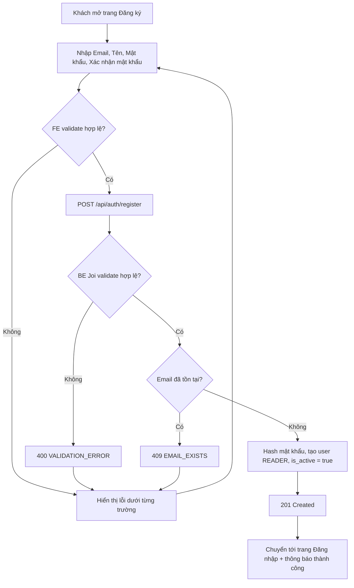

# 2.1.1 Đăng ký

## 1. Tổng quan
- **Actor:** Khách (chưa đăng nhập)
- **Điều kiện tiên quyết:** Không có
- **Kết quả:** Tạo user mới với `role = READER`, `is_active = true`; đăng nhập được ngay.

## 2. Validation rules
| Trường | Quy tắc | Nguồn |
|--------|---------|-------|
| `email` | Bắt buộc, định dạng email hợp lệ, tối đa 255 ký tự, trim + lowercase trước khi lưu | PRD 2.1.1 / Giả định (max, lowercase) |
| `name` | Bắt buộc (sau trim), tối đa 50 ký tự | PRD 2.1.1 |
| `password` | Bắt buộc, 8–16 ký tự | PRD 2.1.1 |
| `confirmPassword` | Bắt buộc, phải trùng `password` | PRD 2.1.1 |

## 3. Quy tắc nghiệp vụ
- BR-01: Email là duy nhất (không phân biệt hoa thường).
- BR-02: Mật khẩu lưu dạng hash bcrypt (cost 10), không bao giờ trả về trong response.
- BR-03: Vai trò luôn là `READER`; mọi trường `role`/`is_active` gửi lên đều bị bỏ qua (Joi `stripUnknown`).
- BR-04: Đăng ký thành công **không** tự đăng nhập — FE chuyển sang trang Đăng nhập kèm thông báo "Đăng ký thành công".

## 4. Flowchart


## 5. Test cases
### Happy cases
| Mã | Mô tả | Kết quả mong đợi |
|----|-------|------------------|
| HC-01 | Đăng ký với dữ liệu hợp lệ | 201, user có `role=READER`, `is_active=true`, response không chứa mật khẩu |
| HC-02 | Email viết hoa `A@Example.com` | Lưu thành `a@example.com` |
| HC-03 | Mật khẩu đúng 8 ký tự và đúng 16 ký tự (biên) | 201 |
| HC-04 | Tên đúng 50 ký tự (biên) | 201 |
| HC-05 | Sau khi đăng ký, đăng nhập bằng tài khoản vừa tạo | Đăng nhập thành công — kiểm thử ở 3.2 (2.1.2) vì cần chức năng đăng nhập |

### Edge cases
| Mã | Mô tả | Kết quả mong đợi |
|----|-------|------------------|
| EC-01 | Email sai định dạng (`abc`, `a@`, `@b.com`) | 400, lỗi trường `email` |
| EC-02 | Email đã tồn tại (khác hoa thường) | 409 `EMAIL_EXISTS` |
| EC-03 | Tên rỗng hoặc chỉ khoảng trắng | 400, lỗi trường `name` |
| EC-04 | Tên 51 ký tự | 400, lỗi trường `name` |
| EC-05 | Mật khẩu 7 ký tự | 400, lỗi trường `password` |
| EC-06 | Mật khẩu 17 ký tự | 400, lỗi trường `password` |
| EC-07 | Mật khẩu rỗng | 400 |
| EC-08 | Confirm mật khẩu không khớp | 400, lỗi trường `confirmPassword` |
| EC-09 | Confirm mật khẩu rỗng | 400 |
| EC-10 | Gửi kèm `role: "ADMIN"` | 201, user vẫn là `READER` |
| EC-11 | Thiếu toàn bộ body | 400, liệt kê lỗi tất cả trường bắt buộc |

## 6. API
### `POST /api/auth/register`
- **Quyền:** Public
- **Request:**
  ```json
  { "email": "a@example.com", "name": "Nguyễn Văn A", "password": "12345678", "confirmPassword": "12345678" }
  ```
- **Response 201:**
  ```json
  { "data": { "id": "uuid", "email": "a@example.com", "name": "Nguyễn Văn A", "role": "READER", "isActive": true, "createdAt": "..." } }
  ```
- **Lỗi:** `400 VALIDATION_ERROR`, `409 EMAIL_EXISTS`

## 7. Giả định / câu hỏi mở
- Không có xác thực email (PRD: kích hoạt ngay).
- Đăng ký xong không tự cấp token (BR-04).
