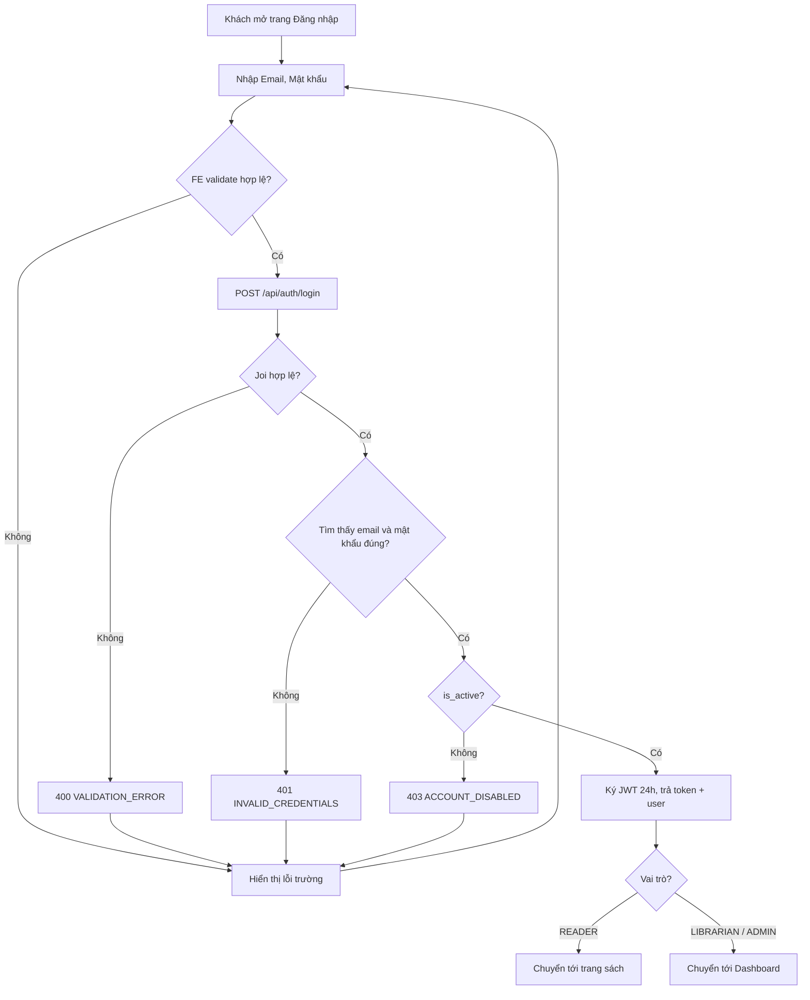

# 2.1.2 Đăng nhập

## 1. Tổng quan
- **Actor:** Khách
- **Điều kiện tiên quyết:** Đã có tài khoản (2.1.1)
- **Kết quả:** Nhận JWT (24h), FE lưu token và chuyển hướng theo vai trò.

## 2. Validation rules
| Trường | Quy tắc | Nguồn |
|--------|---------|-------|
| `email` | Bắt buộc, định dạng email hợp lệ | PRD 2.1.2 |
| `password` | Bắt buộc, 8–16 ký tự | PRD 2.1.2 |

## 3. Quy tắc nghiệp vụ
- BR-01: Sai email **hoặc** sai mật khẩu trả về cùng một lỗi `INVALID_CREDENTIALS` (không tiết lộ email có tồn tại hay không).
- BR-02: Tài khoản `is_active = false` → `403 ACCOUNT_DISABLED` (chỉ trả sau khi mật khẩu đúng).
- BR-03: JWT ký bằng `JWT_SECRET`, `expiresIn: '24h'`, payload `{ sub, role }`.
- BR-04: Chuyển hướng: `READER` → `/` (trang sách) hoặc `/my/loans`; `LIBRARIAN`, `ADMIN` → `/dashboard`.
- BR-05: FE lưu token trong `localStorage`, gắn vào Axios interceptor; gặp `401` → xóa token và chuyển về `/login`.
- BR-06: Đăng xuất chỉ xóa token phía client (JWT stateless).

## 4. Flowchart


## 5. Test cases
### Happy cases
| Mã | Mô tả | Kết quả mong đợi |
|----|-------|------------------|
| HC-01 | Reader đăng nhập đúng | 200, có `token`, `user.role=READER`; FE về trang sách |
| HC-02 | Librarian đăng nhập đúng | 200; FE về `/dashboard` |
| HC-03 | Admin đăng nhập đúng | 200; FE về `/dashboard` |
| HC-04 | Email nhập hoa thường khác lúc đăng ký | 200 |
| HC-05 | Token nhận được gọi `GET /api/auth/me` | 200, trả đúng user |
| HC-06 | Đăng xuất | Token bị xóa, truy cập trang cần login → về `/login` |

### Edge cases
| Mã | Mô tả | Kết quả mong đợi |
|----|-------|------------------|
| EC-01 | Email sai định dạng | 400 |
| EC-02 | Mật khẩu < 8 hoặc > 16 ký tự | 400 |
| EC-03 | Email không tồn tại | 401 `INVALID_CREDENTIALS` |
| EC-04 | Sai mật khẩu | 401 `INVALID_CREDENTIALS` (cùng message với EC-03) |
| EC-05 | Tài khoản bị vô hiệu hóa, mật khẩu đúng | 403 `ACCOUNT_DISABLED` |
| EC-06 | Gọi API bảo vệ với token hết hạn | 401 `UNAUTHORIZED` |
| EC-07 | Gọi API bảo vệ với token bị sửa chữ ký | 401 |
| EC-08 | Gọi API bảo vệ không có header Authorization | 401 |
| EC-09 | Token hợp lệ nhưng user đã bị vô hiệu hóa sau khi login | 401 |
| EC-10 | Reader gọi endpoint Staff | 403 `FORBIDDEN` |

## 6. API
### `POST /api/auth/login`
- **Quyền:** Public
- **Request:** `{ "email": "a@example.com", "password": "12345678" }`
- **Response 200:**
  ```json
  { "data": { "token": "jwt...", "expiresIn": 86400, "user": { "id": "uuid", "email": "...", "name": "...", "role": "READER" } } }
  ```
- **Lỗi:** `400 VALIDATION_ERROR`, `401 INVALID_CREDENTIALS`, `403 ACCOUNT_DISABLED`

### `GET /api/auth/me`
- **Quyền:** Đã đăng nhập (mọi vai trò)
- **Response 200:** `{ "data": { "id", "email", "name", "role", "isActive" } }` — FE dùng để khôi phục phiên khi tải lại trang.
- **Lỗi:** `401 UNAUTHORIZED`

## 7. Giả định / câu hỏi mở
- Không có refresh token, không giới hạn số lần đăng nhập sai (ngoài phạm vi PRD).
