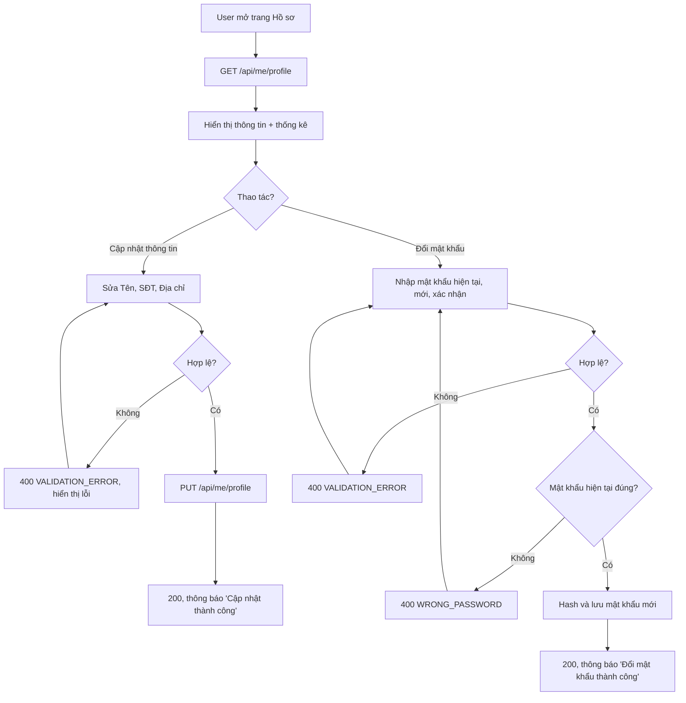

# 2.1.3 Hồ sơ cá nhân

## 1. Tổng quan
- **Actor:** Độc giả (Staff cũng dùng được trang này cho thông tin cơ bản — xem Giả định)
- **Điều kiện tiên quyết:** Đã đăng nhập
- **Kết quả:** Xem thông tin + thống kê cá nhân; cập nhật thông tin; đổi mật khẩu.

## 2. Validation rules
**Cập nhật thông tin** (`PUT /api/me/profile`)
| Trường | Quy tắc | Nguồn |
|--------|---------|-------|
| `name` | Bắt buộc (sau trim), tối đa 50 ký tự | PRD 2.1.3 |
| `phone` | Bắt buộc, số điện thoại VN: `^(0|\+84)(3|5|7|8|9)\d{8}$` | PRD 2.1.3 / Giả định (regex) |
| `address` | Bắt buộc (sau trim), tối đa 255 ký tự | PRD 2.1.3 |

**Đổi mật khẩu** (`PUT /api/me/password`)
| Trường | Quy tắc | Nguồn |
|--------|---------|-------|
| `currentPassword` | Bắt buộc | Giả định |
| `newPassword` | Bắt buộc, 8–16 ký tự, khác `currentPassword` | PRD 2.1.1 (cùng quy tắc mật khẩu) |
| `confirmPassword` | Bắt buộc, trùng `newPassword` | PRD 2.1.1 |

## 3. Quy tắc nghiệp vụ
- BR-01: Email **không** được sửa ở trang này (khóa đăng nhập).
- BR-02: Khi mới đăng ký, `phone` và `address` là `null`; FE hiển thị "Chưa cập nhật".
- BR-03: Thống kê hiển thị:
  - **Ngày tham gia** = `users.created_at`.
  - **Số lần mượn** = số đơn đã được xác nhận (`status IN (BORROWING, OVERDUE, RETURNED)`).
  - **Tổng số tiền phạt** = tổng `fines.amount` của user (mọi trạng thái); hiển thị thêm **Còn nợ** = tổng các phiếu `UNPAID | PENDING | REJECTED`.
- BR-04: Đổi mật khẩu sai `currentPassword` → `400 WRONG_PASSWORD`. Token hiện tại vẫn còn hiệu lực sau khi đổi.

## 4. Flowchart


## 5. Test cases
### Happy cases
| Mã | Mô tả | Kết quả mong đợi |
|----|-------|------------------|
| HC-01 | Xem hồ sơ của reader mới đăng ký | 200; `phone=null`, `address=null`, `borrowCount=0`, `totalFine=0` |
| HC-02 | Xem hồ sơ của reader có 2 đơn đã trả, 1 đơn đang mượn, 1 đơn bị từ chối, 1 đơn chờ xác nhận | `borrowCount=3` |
| HC-03 | Reader có 2 phiếu phạt 20.000 (PAID) và 30.000 (UNPAID) | `totalFine=50000`, `unpaidFine=30000` |
| HC-04 | Cập nhật tên/SĐT/địa chỉ hợp lệ | 200, dữ liệu mới được lưu |
| HC-05 | SĐT dạng `+84912345678` | 200 |
| HC-06 | Đổi mật khẩu hợp lệ, sau đó đăng nhập bằng mật khẩu mới | Thành công; mật khẩu cũ không còn dùng được |

### Edge cases
| Mã | Mô tả | Kết quả mong đợi |
|----|-------|------------------|
| EC-01 | Chưa đăng nhập | 401 |
| EC-02 | Tên rỗng / 51 ký tự | 400 trường `name` |
| EC-03 | SĐT sai định dạng (`123`, `0123456789`, chứa chữ) | 400 trường `phone` |
| EC-04 | Địa chỉ rỗng / 256 ký tự | 400 trường `address` |
| EC-05 | Gửi kèm `email`, `role` trong body cập nhật | Bị bỏ qua, không thay đổi |
| EC-06 | Mật khẩu hiện tại sai | 400 `WRONG_PASSWORD` |
| EC-07 | Mật khẩu mới 7 / 17 ký tự | 400 |
| EC-08 | Xác nhận mật khẩu mới không khớp | 400 |
| EC-09 | Mật khẩu mới trùng mật khẩu hiện tại | 400 trường `newPassword` |

## 6. API
### `GET /api/me/profile`
- **Quyền:** Đã đăng nhập
- **Response 200:**
  ```json
  { "data": { "id": "uuid", "email": "...", "name": "...", "phone": null, "address": null, "role": "READER",
              "createdAt": "...", "stats": { "borrowCount": 3, "totalFine": 50000, "unpaidFine": 30000 } } }
  ```

### `PUT /api/me/profile`
- **Quyền:** Đã đăng nhập
- **Request:** `{ "name": "...", "phone": "0912345678", "address": "..." }`
- **Response 200:** user đã cập nhật (không có `stats`)
- **Lỗi:** `400 VALIDATION_ERROR`, `401`

### `PUT /api/me/password`
- **Quyền:** Đã đăng nhập
- **Request:** `{ "currentPassword": "...", "newPassword": "...", "confirmPassword": "..." }`
- **Response 200:** `{ "data": { "message": "Đổi mật khẩu thành công" } }`
- **Lỗi:** `400 VALIDATION_ERROR`, `400 WRONG_PASSWORD`, `401`

## 7. Giả định / câu hỏi mở
- PRD ghi actor là Độc giả; thiết kế cho mọi vai trò dùng được endpoint `/api/me/*` (Staff cũng cần đổi mật khẩu). Phần `stats` chỉ hiển thị ở FE cho `READER`.
- SĐT là bắt buộc khi cập nhật hồ sơ (PRD chỉ ghi "định dạng hợp lệ") — cần xác nhận.
