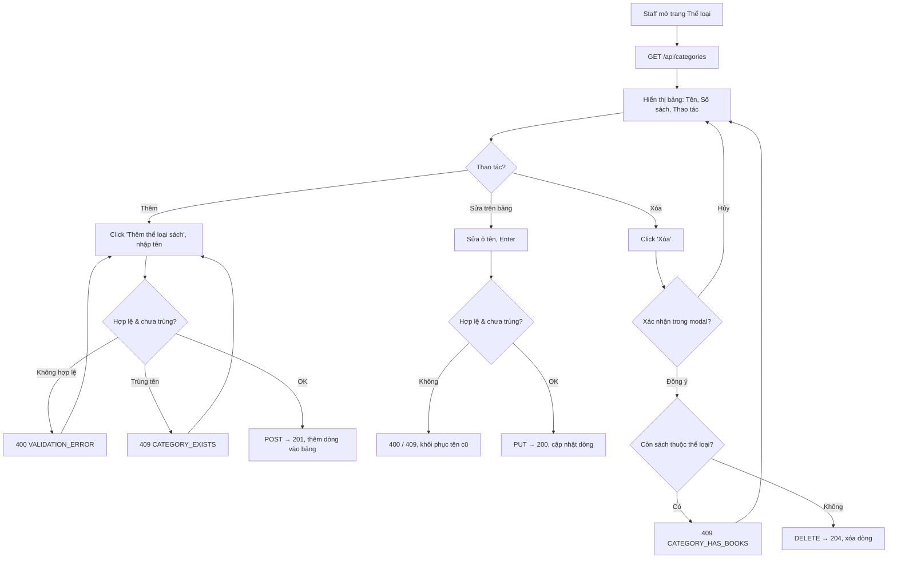

# 2.2.1 Quản lý thể loại sách

## 1. Tổng quan
- **Actor:** Staff (`LIBRARIAN | ADMIN`)
- **Điều kiện tiên quyết:** Đã đăng nhập với vai trò Staff
- **Kết quả:** Xem / thêm / sửa trực tiếp trên bảng / xóa thể loại.

## 2. Validation rules
| Trường | Quy tắc | Nguồn |
|--------|---------|-------|
| `name` | Bắt buộc (sau trim), tối đa 50 ký tự | PRD 2.2.1 |
| `name` | Duy nhất, không phân biệt hoa thường | Giả định |

## 3. Quy tắc nghiệp vụ
- BR-01: Chỉ xóa được khi **không còn sách (chưa bị xóa mềm)** thuộc thể loại → nếu còn: `409 CATEGORY_HAS_BOOKS`.
- BR-02: FE hiển thị modal "Bạn có chắc muốn xóa thể loại X?" trước khi gọi API xóa.
- BR-03: Bảng hiển thị cột `bookCount` (số sách chưa xóa) để nhân viên biết thể loại nào xóa được.
- BR-04: Sửa trực tiếp trên bảng: click ô tên → input → Enter/blur để lưu, Esc để hủy. Lỗi → khôi phục giá trị cũ và hiện thông báo.
- BR-05: `GET /api/categories` là public (dùng cho bộ lọc ở 2.2.3 và form 2.2.2).

## 4. Flowchart

## 5. Test cases
### Happy cases
| Mã | Mô tả | Kết quả mong đợi |
|----|-------|------------------|
| HC-01 | Xem danh sách thể loại | 200, có `bookCount` từng dòng, sắp xếp theo tên A-Z |
| HC-02 | Thêm thể loại "Khoa học" | 201, xuất hiện trong bảng |
| HC-03 | Thêm tên đúng 50 ký tự | 201 |
| HC-04 | Sửa tên trên bảng hợp lệ | 200, tên mới hiển thị |
| HC-05 | Xóa thể loại không có sách (sau khi xác nhận) | 204, biến mất khỏi bảng |
| HC-06 | Xóa thể loại chỉ có sách đã bị xóa mềm | 204 |
| HC-07 | Admin thực hiện thêm/sửa/xóa | Thành công như Librarian |

### Edge cases
| Mã | Mô tả | Kết quả mong đợi |
|----|-------|------------------|
| EC-01 | Tên rỗng / chỉ khoảng trắng | 400 |
| EC-02 | Tên 51 ký tự | 400 |
| EC-03 | Tên trùng (khác hoa thường) khi thêm | 409 `CATEGORY_EXISTS` |
| EC-04 | Sửa thành tên trùng thể loại khác | 409 `CATEGORY_EXISTS` |
| EC-05 | Sửa giữ nguyên tên (chính nó) | 200 |
| EC-06 | Xóa thể loại còn sách | 409 `CATEGORY_HAS_BOOKS` |
| EC-07 | Bấm "Hủy" trong modal xác nhận | Không gọi API, dữ liệu không đổi |
| EC-08 | Sửa/xóa id không tồn tại | 404 |
| EC-09 | Reader gọi POST/PUT/DELETE | 403 |
| EC-10 | Khách gọi POST | 401 |

## 6. API
### `GET /api/categories`
- **Quyền:** Public
- **Response 200:** `{ "data": [ { "id": 1, "name": "Khoa học", "bookCount": 3 } ] }` (không phân trang)

### `POST /api/categories`
- **Quyền:** Staff — **Request:** `{ "name": "Khoa học" }` — **Response 201:** thể loại vừa tạo
- **Lỗi:** `400`, `401`, `403`, `409 CATEGORY_EXISTS`

### `PUT /api/categories/:id`
- **Quyền:** Staff — **Request:** `{ "name": "..." }` — **Response 200**
- **Lỗi:** `400`, `401`, `403`, `404`, `409 CATEGORY_EXISTS`

### `DELETE /api/categories/:id`
- **Quyền:** Staff — **Response 204**
- **Lỗi:** `401`, `403`, `404`, `409 CATEGORY_HAS_BOOKS`

## 7. Giả định / câu hỏi mở
- Tên thể loại duy nhất (PRD không nêu).
