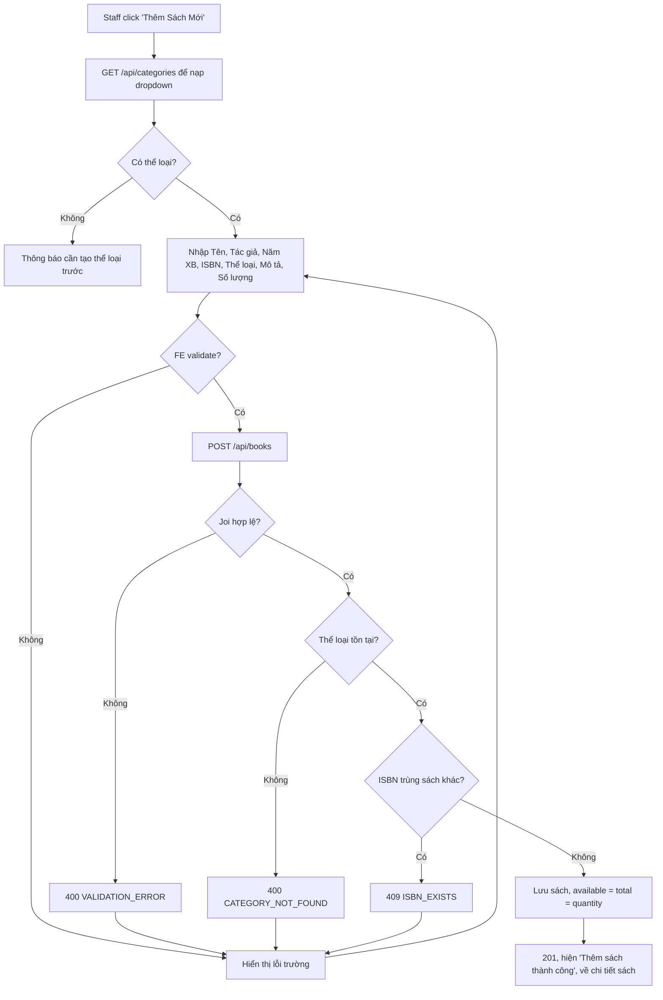

# 2.2.2 Thêm sách mới

## 1. Tổng quan
- **Actor:** Staff
- **Điều kiện tiên quyết:** Đã đăng nhập Staff; tồn tại ít nhất một thể loại (2.2.1)
- **Kết quả:** Sách mới được lưu, `available_quantity = total_quantity`, trạng thái hiển thị "Có sẵn"; FE hiện "Thêm sách thành công".

## 2. Validation rules
| Trường | Quy tắc | Nguồn |
|--------|---------|-------|
| `title` | Bắt buộc (sau trim), tối đa 100 ký tự | PRD 2.2.2 |
| `author` | Bắt buộc (sau trim), tối đa 100 ký tự | PRD 2.2.2 |
| `publishYear` | Bắt buộc, số nguyên, `1900 ≤ năm ≤ năm hiện tại` | PRD 2.2.2 |
| `isbn` | Không bắt buộc; nếu có: bỏ dấu `-`/khoảng trắng rồi phải là ISBN-10 hoặc ISBN-13 hợp lệ (đúng độ dài **và** checksum) | PRD 2.2.2 / Giả định (checksum) |
| `isbn` | Duy nhất trong các sách chưa xóa | Giả định |
| `categoryId` | Bắt buộc, phải tồn tại trong `categories` | PRD 2.2.2 |
| `description` | Bắt buộc (sau trim), tối đa 255 ký tự | PRD 2.2.2 |
| `quantity` | Bắt buộc, số nguyên `> 0` (tối đa 9999) | PRD 2.2.2 / Giả định (max) |

## 3. Quy tắc nghiệp vụ
- BR-01: Khi tạo: `total_quantity = available_quantity = quantity`; `borrowed/damaged/lost_quantity = 0`; `borrow_count = 0`.
- BR-02: Trạng thái sách **không lưu** mà suy ra: `available_quantity > 0` → "Có sẵn", ngược lại "Hết sách".
- BR-03: ISBN được chuẩn hóa (chỉ giữ chữ số và `X` cuối của ISBN-10) trước khi lưu.
- BR-04: Nếu chưa có thể loại nào, FE hiện thông báo "Cần tạo thể loại trước" và link tới trang thể loại.

## 4. Flowchart


## 5. Test cases
### Happy cases
| Mã | Mô tả | Kết quả mong đợi |
|----|-------|------------------|
| HC-01 | Thêm sách đầy đủ trường hợp lệ, ISBN-13 | 201; `availableQuantity = totalQuantity = quantity`; `status = "AVAILABLE"` |
| HC-02 | Thêm sách không có ISBN | 201, `isbn = null` |
| HC-03 | ISBN-10 hợp lệ có chữ `X` cuối (`080442957X`) | 201 |
| HC-04 | ISBN có dấu gạch `978-0-306-40615-7` | 201, lưu `9780306406157` |
| HC-05 | Năm XB = 1900 và = năm hiện tại (biên) | 201 |
| HC-06 | Số lượng = 1 (biên) | 201 |
| HC-07 | FE hiển thị "Thêm sách thành công" | Toast hiển thị |

### Edge cases
| Mã | Mô tả | Kết quả mong đợi |
|----|-------|------------------|
| EC-01 | Tên rỗng / 101 ký tự | 400 `title` |
| EC-02 | Tác giả rỗng / 101 ký tự | 400 `author` |
| EC-03 | Năm XB 1899 / năm hiện tại + 1 / không phải số | 400 `publishYear` |
| EC-04 | ISBN sai độ dài (`12345`) | 400 `isbn` |
| EC-05 | ISBN đúng độ dài nhưng sai checksum (`9780306406158`) | 400 `isbn` |
| EC-06 | ISBN trùng sách đang tồn tại | 409 `ISBN_EXISTS` |
| EC-07 | ISBN trùng sách đã bị xóa mềm | 201 |
| EC-08 | Không chọn thể loại | 400 `categoryId` |
| EC-09 | `categoryId` không tồn tại | 400 `CATEGORY_NOT_FOUND` |
| EC-10 | Mô tả rỗng / 256 ký tự | 400 `description` |
| EC-11 | Số lượng 0 / âm / 1.5 / chuỗi `"abc"` | 400 `quantity` |
| EC-12 | Reader gọi API | 403 |
| EC-13 | Chưa có thể loại nào | FE hiển thị thông báo, không render form |

## 6. API
### `POST /api/books`
- **Quyền:** Staff
- **Request:**
  ```json
  { "title": "Clean Code", "author": "Robert C. Martin", "publishYear": 2008, "isbn": "9780132350884",
    "categoryId": 1, "description": "...", "quantity": 5 }
  ```
- **Response 201:**
  ```json
  { "data": { "id": "uuid", "title": "Clean Code", "author": "...", "publishYear": 2008, "isbn": "9780132350884",
              "category": { "id": 1, "name": "CNTT" }, "description": "...",
              "totalQuantity": 5, "availableQuantity": 5, "borrowedQuantity": 0, "damagedQuantity": 0, "lostQuantity": 0,
              "borrowCount": 0, "status": "AVAILABLE", "createdAt": "..." } }
  ```
- **Lỗi:** `400 VALIDATION_ERROR`, `400 CATEGORY_NOT_FOUND`, `401`, `403`, `409 ISBN_EXISTS`

## 7. Giả định / câu hỏi mở
- Kiểm tra checksum ISBN; ISBN duy nhất; số lượng tối đa 9999 — người dùng đã xác nhận (3.5).
- Tạm thời (3.5): sau khi thêm, FE ở lại form và hiện "Thêm sách thành công" (trang chi tiết sách làm ở 3.7); lối vào là link "Thêm sách" trên header Staff (chuyển thành nút ở trang danh sách khi làm 3.6).
- EC-07 (ISBN trùng sách đã xóa mềm) hiện chỉ có unit test; bổ sung API/E2E khi xong 3.8.
- Không có ảnh bìa (PRD không yêu cầu). Nếu cần, có thể thêm `cover_url` dùng Supabase Storage.
