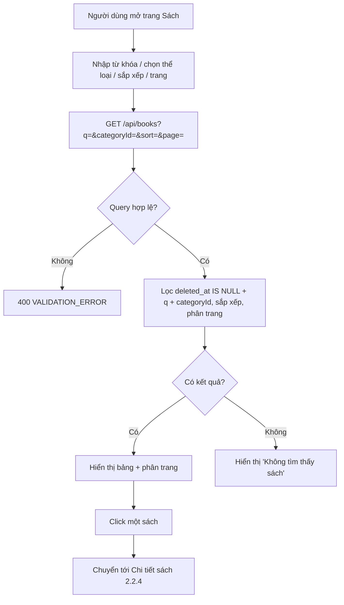

# 2.2.3 Xem danh sách sách

## 1. Tổng quan
- **Actor:** Tất cả (không cần đăng nhập)
- **Điều kiện tiên quyết:** Không có
- **Kết quả:** Danh sách sách phân trang 10/trang, có tìm kiếm, lọc, sắp xếp.

## 2. Validation rules (query string)
| Tham số | Quy tắc | Nguồn |
|---------|---------|-------|
| `q` | Không bắt buộc, trim, tối đa 100 ký tự; tìm trong `title` **hoặc** `author` (ILIKE `%q%`) | PRD 2.2.3 |
| `categoryId` | Không bắt buộc, số nguyên dương | PRD 2.2.3 |
| `sort` | `title` (A-Z, mặc định) \| `newest` (năm XB giảm dần) \| `popular` (`borrow_count` giảm dần) | PRD 2.2.3 |
| `page` | Số nguyên ≥ 1, mặc định 1 | PRD 2.2.3 |
| `limit` | Cố định 10 cho trang này (BE cho phép 1–100, mặc định 10) | PRD 2.2.3 |

## 3. Quy tắc nghiệp vụ
- BR-01: Chỉ hiển thị sách chưa xóa mềm (`deleted_at IS NULL`).
- BR-02: Cột hiển thị: Tên, Tác giả, Năm XB, Thể loại, **Số lượng có sẵn** (`available_quantity`), **Số lượng đang mượn** (`borrowed_quantity`).
- BR-03: Sắp xếp phụ cố định theo `id` để phân trang ổn định khi giá trị sắp xếp trùng nhau.
- BR-04: "Lượt mượn" = `borrow_count` (tăng khi Staff xác nhận đơn mượn ở 2.3.2).
- BR-05: Tham số không hợp lệ (`page=0`, `sort=abc`) → `400`. FE đồng bộ bộ lọc lên URL query để có thể chia sẻ link.
- BR-06: `page` vượt `totalPages` → trả `data: []` (không lỗi).

## 4. Flowchart


## 5. Test cases
### Happy cases
| Mã | Mô tả | Kết quả mong đợi |
|----|-------|------------------|
| HC-01 | Khách (không token) xem danh sách | 200, tối đa 10 sách, có `meta` |
| HC-02 | 25 sách, `page=3` | 5 sách, `totalPages=3` |
| HC-03 | Tìm `q=martin` khớp tác giả "Robert C. Martin" | Có sách đó |
| HC-04 | Tìm theo một phần tên, khác hoa thường | Có kết quả đúng |
| HC-05 | Lọc `categoryId` | Chỉ sách thuộc thể loại đó |
| HC-06 | Kết hợp `q` + `categoryId` + `sort=newest` | Kết quả thỏa cả hai điều kiện, năm XB giảm dần |
| HC-07 | `sort=popular` | `borrow_count` giảm dần |
| HC-08 | Mặc định không truyền `sort` | Tên A-Z |
| HC-09 | Hiển thị số lượng có sẵn và đang mượn đúng với DB | Khớp |

### Edge cases
| Mã | Mô tả | Kết quả mong đợi |
|----|-------|------------------|
| EC-01 | Sách đã xóa mềm | Không xuất hiện |
| EC-02 | `q` không khớp gì | `data: []`, FE hiện "Không tìm thấy sách" |
| EC-03 | `q` chứa ký tự đặc biệt `%`, `_`, `'` | Không lỗi, ký tự được escape |
| EC-04 | `page=0` / `page=-1` / `page=abc` | 400 |
| EC-05 | `sort=abc` | 400 |
| EC-06 | `page` vượt quá tổng số trang | 200, `data: []` |
| EC-07 | `categoryId` không tồn tại | 200, `data: []` |
| EC-08 | DB chưa có sách nào | 200, `data: []`, `total=0` |

## 6. API
### `GET /api/books`
- **Quyền:** Public
- **Query:** `q`, `categoryId`, `sort`, `page`, `limit`
- **Response 200:**
  ```json
  { "data": [ { "id": "uuid", "title": "...", "author": "...", "publishYear": 2008,
                "category": { "id": 1, "name": "CNTT" }, "availableQuantity": 3, "borrowedQuantity": 2,
                "borrowCount": 12, "status": "AVAILABLE" } ],
    "meta": { "page": 1, "limit": 10, "total": 25, "totalPages": 3 } }
  ```
- **Lỗi:** `400 VALIDATION_ERROR`

## 7. Giả định / ghi chú triển khai (3.6)
- Trang danh sách sách là trang chủ `/` (thay trang giới thiệu tạm). Staff thấy nút "Thêm Sách Mới" → `/books/new` (thay link "Thêm sách" tạm trên header).
- Tên sách chưa bấm được; link tới Chi tiết sách bổ sung ở 3.7 (2.2.4).
- EC-03: Prisma `contains` **không** tự escape `%`/`_` (đã kiểm tra trên DB thật) → BE tự escape `\`, `%`, `_` trước khi truy vấn.
- FE bỏ qua tham số sai trên URL (`page=abc`, `sort=xyz`) và dùng mặc định thay vì gọi API nhận 400; BE vẫn trả 400 (BR-05).
- `q` tối đa 100 ký tự; `limit` 1–100 (FE luôn gửi 10).
- EC-01 (sách xóa mềm), EC-08 (DB rỗng) và HC-07 với lượt mượn thật hiện chỉ có unit test; bổ sung API/E2E khi xong 3.8 (xóa sách) / 3.9, 3.13 (mượn sách).
