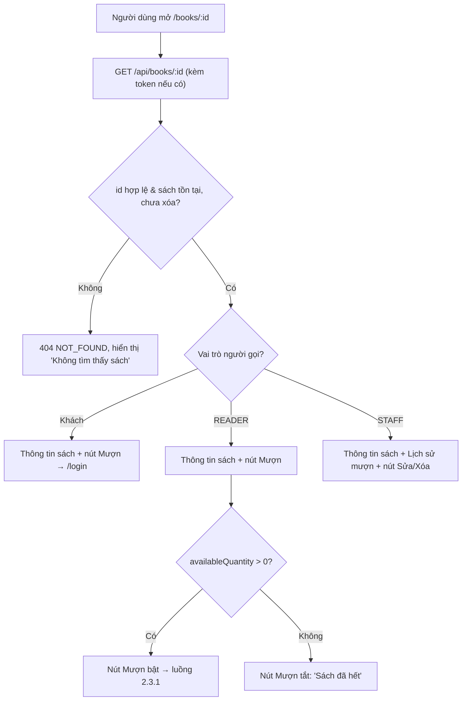

# 2.2.4 Xem chi tiết sách

## 1. Tổng quan
- **Actor:** Tất cả (không cần đăng nhập)
- **Điều kiện tiên quyết:** Sách tồn tại, chưa bị xóa mềm
- **Kết quả:** Hiển thị thông tin sách; Staff thấy thêm lịch sử mượn; Reader thấy nút "Mượn sách"; Staff thấy nút "Sửa"/"Xóa" (2.2.5).

## 2. Validation rules
| Tham số | Quy tắc | Nguồn |
|---------|---------|-------|
| `:id` | UUID hợp lệ | Giả định |

## 3. Quy tắc nghiệp vụ
- BR-01: Hiển thị: Tên, Tác giả, ISBN, Năm XB, Thể loại, Mô tả, Số lượng có sẵn, Số lượng đang mượn.
- BR-02: **Lịch sử mượn** (Độc giả, Ngày mượn, Ngày hết hạn, Trạng thái) **chỉ trả về khi người gọi là Staff**. Gồm các đơn đã xác nhận (`BORROWING | OVERDUE | RETURNED`), mới nhất trước, tối đa 50 dòng gần nhất.
- BR-03: Endpoint dùng *optional auth*: có token hợp lệ → nhận diện vai trò; không token → khách. Token sai/hết hạn → coi như khách (không báo lỗi).
- BR-04: Nút "Mượn sách":
  - Khách → bấm sẽ chuyển tới `/login`.
  - Reader → mở modal chọn thời hạn (2.3.1). Nút bị vô hiệu kèm lý do khi `availableQuantity = 0`.
  - Staff → không hiển thị.
- BR-05: Sách đã xóa mềm → `404`.

## 4. Flowchart


## 5. Test cases
### Happy cases
| Mã | Mô tả | Kết quả mong đợi |
|----|-------|------------------|
| HC-01 | Khách xem chi tiết | 200, đủ trường BR-01, **không** có `loanHistory` |
| HC-02 | Reader xem chi tiết | 200, không có `loanHistory`, FE hiển thị nút "Mượn sách" |
| HC-03 | Librarian xem chi tiết sách đã có đơn mượn | 200, có `loanHistory` với tên độc giả, ngày mượn, hạn trả |
| HC-04 | Admin xem chi tiết | Có `loanHistory` |
| HC-05 | Khách bấm "Mượn sách" | Chuyển tới trang đăng nhập |

### Edge cases
| Mã | Mô tả | Kết quả mong đợi |
|----|-------|------------------|
| EC-01 | id không tồn tại | 404 |
| EC-02 | id không phải UUID | 404 (không 500) |
| EC-03 | Sách đã xóa mềm | 404 |
| EC-04 | Token hết hạn gửi kèm | 200, xử lý như khách |
| EC-05 | Sách có `availableQuantity = 0` | Reader thấy nút Mượn bị vô hiệu |
| EC-06 | `loanHistory` không chứa đơn `PENDING` / `REJECTED` | Đúng |

## 6. API
### `GET /api/books/:id`
- **Quyền:** Public (optional auth)
- **Response 200:**
  ```json
  { "data": { "id": "uuid", "title": "...", "author": "...", "isbn": "...", "publishYear": 2008, "description": "...",
              "category": { "id": 1, "name": "CNTT" },
              "totalQuantity": 5, "availableQuantity": 3, "borrowedQuantity": 2, "status": "AVAILABLE",
              "loanHistory": [ { "loanId": "uuid", "reader": { "id": "uuid", "name": "..." },
                                 "borrowDate": "2026-10-01", "dueDate": "2026-10-15", "status": "RETURNED" } ] } }
  ```
  (`loanHistory` chỉ có khi người gọi là Staff; Staff cũng nhận thêm `damagedQuantity`, `lostQuantity`.)
- **Lỗi:** `404 NOT_FOUND`
