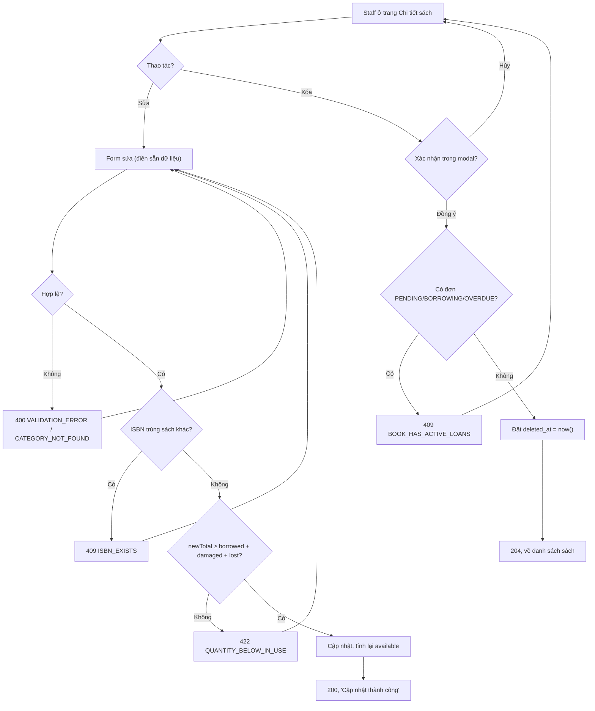

# 2.2.5 Sửa & Xóa sách

## 1. Tổng quan
- **Actor:** Staff
- **Điều kiện tiên quyết:** Đã đăng nhập Staff; đang ở trang chi tiết sách (2.2.4)
- **Kết quả:** Sửa thông tin sách; hoặc xóa (mềm) sách khi không có đơn mượn hoạt động.

## 2. Validation rules
Giống [2.2.2](2.2.2-them-sach.md) cho `title`, `author`, `publishYear`, `isbn`, `categoryId`, `description`. Riêng số lượng:

| Trường | Quy tắc | Nguồn |
|--------|---------|-------|
| `totalQuantity` | Bắt buộc, số nguyên > 0, tối đa 9999, và `≥ borrowed + damaged + lost` | PRD 2.2.2 / Giả định |

## 3. Quy tắc nghiệp vụ
- BR-01 (Sửa số lượng): Staff sửa **tổng số bản** (`totalQuantity`). `available_quantity` được tính lại: `available = newTotal − borrowed − damaged − lost`. Nếu kết quả < 0 → `422 QUANTITY_BELOW_IN_USE`.
- BR-02 (Sửa ISBN): kiểm tra trùng với sách khác chưa xóa (bỏ qua chính nó).
- BR-03 (Xóa): chỉ xóa khi **không có đơn mượn hoạt động** (`PENDING | BORROWING | OVERDUE`) → nếu có: `409 BOOK_HAS_ACTIVE_LOANS`.
- BR-04 (Xóa mềm): đặt `deleted_at = now()` để giữ lịch sử mượn và phiếu phạt. Sách đã xóa không xuất hiện ở 2.2.3/2.2.4, không mượn được, không tính vào dashboard.
- BR-05: FE hiển thị modal xác nhận trước khi xóa; xóa thành công → về trang danh sách.
- BR-06: Sửa/xóa thực hiện trong transaction với `SELECT ... FOR UPDATE` trên dòng sách để tránh xung đột với xác nhận mượn đồng thời.

## 4. Flowchart

## 5. Test cases
### Happy cases
| Mã | Mô tả | Kết quả mong đợi |
|----|-------|------------------|
| HC-01 | Sửa tên, tác giả, mô tả hợp lệ | 200, dữ liệu cập nhật |
| HC-02 | Tăng `totalQuantity` 5 → 8 khi đang có 2 bản mượn | `available` 3 → 6 |
| HC-03 | Giảm `totalQuantity` 5 → 2 khi đang mượn 2 | `available = 0` |
| HC-04 | Sửa ISBN giữ nguyên giá trị cũ | 200 |
| HC-05 | Đổi thể loại | 200, thể loại mới |
| HC-06 | Xóa sách chưa từng được mượn | 204; không còn trong danh sách |
| HC-07 | Xóa sách chỉ có đơn `RETURNED`/`REJECTED` | 204; lịch sử mượn của độc giả vẫn hiển thị tên sách |

### Edge cases
| Mã | Mô tả | Kết quả mong đợi |
|----|-------|------------------|
| EC-01 | Các lỗi validation như 2.2.2 EC-01…EC-11 | 400 |
| EC-02 | ISBN trùng sách khác | 409 `ISBN_EXISTS` |
| EC-03 | Giảm `totalQuantity` 5 → 1 khi đang mượn 2 | 422 `QUANTITY_BELOW_IN_USE` |
| EC-04 | Xóa sách có đơn `PENDING` | 409 `BOOK_HAS_ACTIVE_LOANS` |
| EC-05 | Xóa sách có đơn `BORROWING` hoặc `OVERDUE` | 409 `BOOK_HAS_ACTIVE_LOANS` |
| EC-06 | Sửa/xóa sách không tồn tại hoặc đã xóa | 404 |
| EC-07 | Reader gọi PUT/DELETE | 403 |
| EC-08 | Bấm "Hủy" trong modal xóa | Không gọi API |

## 6. API
### `PUT /api/books/:id`
- **Quyền:** Staff
- **Request:** như `POST /api/books` nhưng `quantity` → `totalQuantity`
- **Response 200:** sách đã cập nhật (cùng shape 2.2.2)
- **Lỗi:** `400`, `401`, `403`, `404`, `409 ISBN_EXISTS`, `422 QUANTITY_BELOW_IN_USE`

### `DELETE /api/books/:id`
- **Quyền:** Staff — **Response 204**
- **Lỗi:** `401`, `403`, `404`, `409 BOOK_HAS_ACTIVE_LOANS`

## 7. Giả định / câu hỏi mở
- Xóa mềm thay vì xóa cứng (để giữ toàn vẹn lịch sử mượn/phạt).
- Số lượng hư hỏng/mất chỉ thay đổi qua luồng trả sách 2.4.2, không sửa tay.
