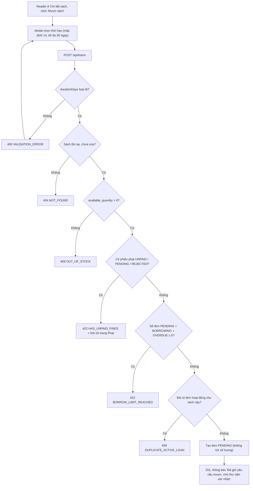

# 2.3.1 Mượn sách (Độc giả)

## 1. Tổng quan
- **Actor:** Độc giả (`READER`)
- **Điều kiện tiên quyết:** Đã đăng nhập Reader; đang ở trang chi tiết sách (2.2.4)
- **Kết quả:** Tạo đơn mượn trạng thái `PENDING` ("Chờ xác nhận"). **Số lượng sách chưa thay đổi.**

## 2. Validation rules
| Trường | Quy tắc | Nguồn |
|--------|---------|-------|
| `bookId` | Bắt buộc, UUID, sách tồn tại và chưa xóa | PRD 2.3.1 |
| `durationDays` | Số nguyên, `1 ≤ x ≤ 30`, mặc định 14 | PRD 2.3.1 |

## 3. Quy tắc nghiệp vụ
Kiểm tra theo đúng thứ tự sau (lỗi đầu tiên gặp phải sẽ được trả về):
- BR-01: Sách còn sẵn: `available_quantity > 0` → nếu không: `409 OUT_OF_STOCK`.
- BR-02: Không có phiếu phạt chưa thanh toán — phiếu `UNPAID`, `PENDING` hoặc `REJECTED` đều tính → nếu có: `422 HAS_UNPAID_FINES`.
- BR-03: Số đơn hoạt động (`PENDING + BORROWING + OVERDUE`) của độc giả `< 5` → nếu đủ 5: `422 BORROW_LIMIT_REACHED`.
- BR-04: Không có đơn hoạt động khác cho **cùng cuốn sách** → nếu có: `409 DUPLICATE_ACTIVE_LOAN` *(giả định)*.
- BR-05: Gọi `refreshOverdueLoans()` trước khi đếm (BR-03).
- BR-06: Toàn bộ kiểm tra + insert chạy trong transaction, khóa dòng user (`SELECT ... FROM users WHERE id = $1 FOR UPDATE`) để 2 request song song không vượt giới hạn 5.
- BR-07: Đơn mới: `status = PENDING`, `duration_days`, `requested_at = now()`; `borrow_date`, `due_date` = `null` (được đặt khi Staff xác nhận — 2.3.2).
- BR-08: Giới hạn 5 cuốn là hằng số cấu hình `MAX_ACTIVE_LOANS = 5` (env, mặc định 5).

## 4. Flowchart


## 5. Test cases
### Happy cases
| Mã | Mô tả | Kết quả mong đợi |
|----|-------|------------------|
| HC-01 | Mượn với thời hạn mặc định (không gửi `durationDays`) | 201, `status=PENDING`, `durationDays=14` |
| HC-02 | `durationDays = 1` và `= 30` (biên) | 201 |
| HC-03 | Sau khi tạo đơn, `availableQuantity` của sách | **Không đổi** |
| HC-04 | Reader có 4 đơn hoạt động tạo đơn thứ 5 | 201 |
| HC-05 | Reader có phiếu phạt duy nhất ở trạng thái `PAID` | 201 |
| HC-06 | Reader có đơn `RETURNED` / `REJECTED` cho cùng sách | 201 (không tính là trùng) |
| HC-07 | Đơn mới xuất hiện ở Lịch sử mượn (2.3.3) với trạng thái "Chờ xác nhận" | Đúng |

### Edge cases
| Mã | Mô tả | Kết quả mong đợi |
|----|-------|------------------|
| EC-01 | `durationDays = 0` / `31` / `7.5` / `"abc"` | 400 |
| EC-02 | Sách không tồn tại / đã xóa mềm | 404 |
| EC-03 | Sách `available_quantity = 0` | 409 `OUT_OF_STOCK` |
| EC-04 | Có phiếu phạt `UNPAID` | 422 `HAS_UNPAID_FINES` |
| EC-05 | Có phiếu phạt `PENDING` (đã báo chuyển khoản, chờ xác nhận) | 422 `HAS_UNPAID_FINES` |
| EC-06 | Có phiếu phạt `REJECTED` | 422 `HAS_UNPAID_FINES` |
| EC-07 | Có 5 đơn hoạt động (ví dụ 2 PENDING + 2 BORROWING + 1 OVERDUE) | 422 `BORROW_LIMIT_REACHED` |
| EC-08 | Có 4 đơn BORROWING trong đó 1 đơn đã quá hạn nhưng DB chưa cập nhật + 1 PENDING | Sau `refreshOverdueLoans` vẫn đếm = 5 → 422 |
| EC-09 | Đã có đơn `PENDING` cho cùng sách | 409 `DUPLICATE_ACTIVE_LOAN` |
| EC-10 | 2 request song song khi đang có 4 đơn hoạt động (khác sách) | Chỉ 1 request thành công, request còn lại 422 |
| EC-11 | Librarian/Admin gọi API | 403 |
| EC-12 | Khách gọi API | 401 |

## 6. API
### `POST /api/loans`
- **Quyền:** `READER`
- **Request:** `{ "bookId": "uuid", "durationDays": 14 }`
- **Response 201:**
  ```json
  { "data": { "id": "uuid", "status": "PENDING", "durationDays": 14, "requestedAt": "...",
              "book": { "id": "uuid", "title": "..." }, "borrowDate": null, "dueDate": null } }
  ```
- **Lỗi:** `400 VALIDATION_ERROR`, `401`, `403`, `404`, `409 OUT_OF_STOCK`, `409 DUPLICATE_ACTIVE_LOAN`, `422 HAS_UNPAID_FINES`, `422 BORROW_LIMIT_REACHED`

## 7. Giả định / câu hỏi mở
- BR-04 (không mượn trùng sách đang có đơn hoạt động) không có trong PRD — cần xác nhận.
- Ngày mượn và hạn trả được tính từ lúc Staff xác nhận, không phải lúc tạo đơn (độc giả chỉ có sách khi nhận).
- PRD không có chức năng độc giả hủy đơn `PENDING` → không làm.
