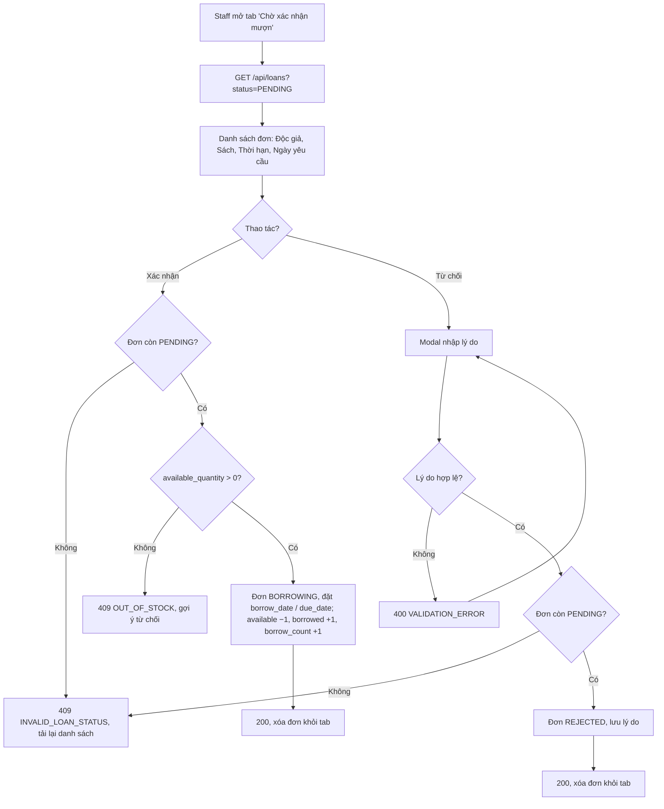

# 2.3.2 Mượn sách (Nhân viên — xác nhận / từ chối)

## 1. Tổng quan
- **Actor:** Staff
- **Điều kiện tiên quyết:** Đã đăng nhập Staff; có đơn `PENDING` (2.3.1)
- **Kết quả:** Xác nhận → đơn `BORROWING`, giảm số lượng có sẵn. Từ chối → đơn `REJECTED` kèm lý do.

## 2. Validation rules
| Trường | Quy tắc | Nguồn |
|--------|---------|-------|
| `reason` (từ chối) | Bắt buộc (sau trim), tối đa 255 ký tự | PRD 2.3.2 / Giả định (max) |

## 3. Quy tắc nghiệp vụ
- BR-01: Trang "Quản lý mượn trả" có các tab: **Chờ xác nhận mượn** (đơn `PENDING`), **Đang mượn** (`BORROWING | OVERDUE`), **Chờ xác nhận trả** (2.4.2), **Lịch sử** (tất cả). Có tìm kiếm theo tên/email độc giả hoặc tên sách.
- BR-02: Chỉ thao tác được trên đơn `PENDING` → khác: `409 INVALID_LOAN_STATUS`.
- BR-03 (Xác nhận), trong transaction và khóa dòng sách (`FOR UPDATE`):
  - Nếu `available_quantity = 0` → `409 OUT_OF_STOCK` (nhân viên nên từ chối đơn).
  - `loans`: `status = BORROWING`, `borrow_date = today_vn`, `due_date = borrow_date + duration_days`, `confirmed_by`, `confirmed_at = now()`.
  - `books`: `available_quantity −1`, `borrowed_quantity +1`, `borrow_count +1`.
- BR-04 (Từ chối): `status = REJECTED`, `reject_reason`, `rejected_by`, `rejected_at = now()`. Không thay đổi số lượng sách.
- BR-05: Xác nhận dùng `UPDATE ... WHERE id = $1 AND status = 'PENDING'` để 2 nhân viên bấm cùng lúc không xác nhận trùng (request sau nhận 409).

## 4. Flowchart


## 5. Test cases
### Happy cases
| Mã | Mô tả | Kết quả mong đợi |
|----|-------|------------------|
| HC-01 | Xem danh sách đơn `PENDING` | 200, chỉ có đơn `PENDING`, cũ nhất trước |
| HC-02 | Xác nhận đơn (sách còn 3) | 200; đơn `BORROWING`; `borrowDate = hôm nay`; `dueDate = hôm nay + durationDays`; sách `available=2`, `borrowed +1`, `borrowCount +1` |
| HC-03 | Xác nhận đơn có `durationDays=30` | `dueDate = hôm nay + 30` |
| HC-04 | Từ chối với lý do hợp lệ | 200; đơn `REJECTED`, `rejectReason` được lưu; số lượng sách không đổi |
| HC-05 | Reader xem lịch sử sau khi bị từ chối | Thấy trạng thái "Bị từ chối" và lý do |
| HC-06 | Admin xác nhận/từ chối | Thành công |
| HC-07 | Tìm kiếm theo tên độc giả trong tab | Lọc đúng |

### Edge cases
| Mã | Mô tả | Kết quả mong đợi |
|----|-------|------------------|
| EC-01 | Từ chối không nhập lý do / chỉ khoảng trắng | 400 |
| EC-02 | Lý do 256 ký tự | 400 |
| EC-03 | Xác nhận đơn đã `BORROWING` / `REJECTED` | 409 `INVALID_LOAN_STATUS` |
| EC-04 | Từ chối đơn đã xác nhận | 409 `INVALID_LOAN_STATUS` |
| EC-05 | Sách có 1 bản, 2 đơn `PENDING`: xác nhận đơn 1 rồi đơn 2 | Đơn 2 → 409 `OUT_OF_STOCK` |
| EC-06 | Hai nhân viên cùng xác nhận một đơn đồng thời | 1 thành công, 1 nhận 409; số lượng chỉ giảm 1 |
| EC-07 | Đơn không tồn tại | 404 |
| EC-08 | Reader gọi API xác nhận/từ chối | 403 |

## 6. API
### `GET /api/loans`
- **Quyền:** Staff
- **Query:** `status` (một hoặc nhiều, phân tách dấu phẩy: `PENDING`, `BORROWING,OVERDUE`...), `q` (tên/email độc giả, tên sách), `page`, `limit`
- **Response 200:**
  ```json
  { "data": [ { "id": "uuid", "status": "PENDING", "durationDays": 14, "requestedAt": "...",
                "borrowDate": null, "dueDate": null,
                "reader": { "id": "uuid", "name": "...", "email": "..." },
                "book": { "id": "uuid", "title": "...", "availableQuantity": 2 } } ],
    "meta": { "page": 1, "limit": 10, "total": 1, "totalPages": 1 } }
  ```

### `POST /api/loans/:id/confirm`
- **Quyền:** Staff — **Request:** không có body — **Response 200:** đơn đã cập nhật
- **Lỗi:** `401`, `403`, `404`, `409 INVALID_LOAN_STATUS`, `409 OUT_OF_STOCK`

### `POST /api/loans/:id/reject`
- **Quyền:** Staff — **Request:** `{ "reason": "Sách đang được bảo trì" }` — **Response 200:** đơn đã cập nhật
- **Lỗi:** `400`, `401`, `403`, `404`, `409 INVALID_LOAN_STATUS`
