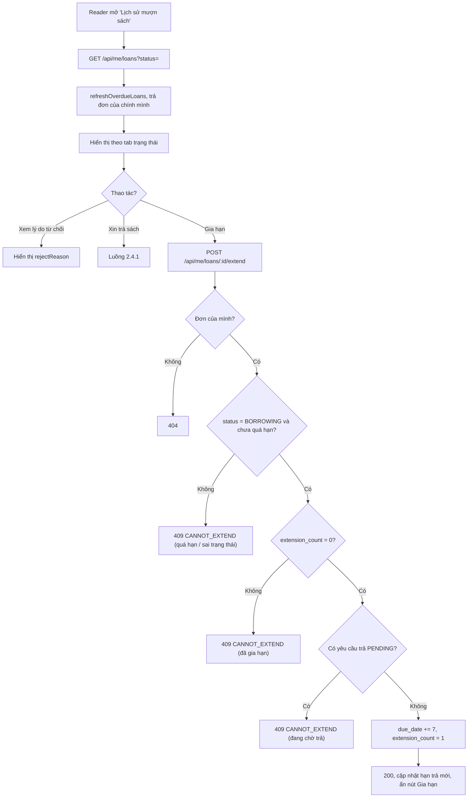

# 2.3.3 Xem lịch sử mượn sách & Gia hạn (Độc giả)

## 1. Tổng quan
- **Actor:** Độc giả
- **Điều kiện tiên quyết:** Đã đăng nhập Reader
- **Kết quả:** Xem các đơn của chính mình theo trạng thái; xem lý do từ chối; gia hạn (+7 ngày, 1 lần); tạo yêu cầu trả (→ 2.4.1).

## 2. Validation rules
| Tham số | Quy tắc | Nguồn |
|---------|---------|-------|
| `status` | Không bắt buộc; một trong `PENDING`, `BORROWING`, `OVERDUE`, `RETURNED`, `REJECTED` | PRD 2.3.3 |
| `page`, `limit` | Như quy ước chung | — |

## 3. Quy tắc nghiệp vụ
- BR-01: Chỉ trả về đơn của chính người gọi. Gọi `refreshOverdueLoans()` trước khi truy vấn.
- BR-02: Hiển thị theo nhóm (FE chia tab / lọc theo trạng thái):
  - **Đang mượn** (`BORROWING`, `OVERDUE`): Tên, Tác giả, Ngày mượn, Hạn trả, Số ngày còn lại (`due_date − today_vn`; âm → hiển thị "Quá hạn N ngày").
  - **Đã trả** (`RETURNED`): Tên, Ngày mượn, Ngày trả.
  - **Bị từ chối** (`REJECTED`): Tên, Tác giả, Lý do từ chối.
  - **Chờ xác nhận** (`PENDING`): Tên, Tác giả, Thời hạn đăng ký, Ngày yêu cầu.
- BR-03: Mỗi đơn trả kèm cờ do BE tính sẵn: `canExtend`, `canRequestReturn`, `hasPendingReturn`.
- BR-04 (Gia hạn) — điều kiện `canExtend`:
  - `status = BORROWING` (đơn `OVERDUE` không được gia hạn);
  - `extension_count = 0` (tối đa 1 lần);
  - `today_vn ≤ due_date` (chưa hết hạn);
  - không có yêu cầu trả `PENDING` *(giả định)*.
  - Kết quả: `due_date += 7`, `extension_count = 1`, `extended_at = now()`.
- BR-05: Sai điều kiện gia hạn → `409 CANNOT_EXTEND` với `message` nêu lý do cụ thể (đã gia hạn / đã quá hạn / đang chờ trả / sai trạng thái).
- BR-06: Đơn của người khác → `404` (không tiết lộ tồn tại).

## 4. Flowchart


## 5. Test cases
### Happy cases
| Mã | Mô tả | Kết quả mong đợi |
|----|-------|------------------|
| HC-01 | Xem lịch sử khi có đơn ở đủ 5 trạng thái | 200, đủ các đơn, mỗi đơn có trường đúng theo BR-02 |
| HC-02 | Lọc `status=REJECTED` | Chỉ đơn bị từ chối, có `rejectReason` |
| HC-03 | Đơn `BORROWING` hạn trả sau 3 ngày | `daysRemaining = 3`, `canExtend = true` |
| HC-04 | Gia hạn đơn hợp lệ | 200, `dueDate` +7, `extensionCount = 1`, `canExtend = false` |
| HC-05 | Gia hạn đúng vào ngày hết hạn (`today = due_date`) | 200 |
| HC-06 | Đơn `RETURNED` hiển thị ngày trả | Có `returnedAt` |
| HC-07 | Reader mới, chưa có đơn | `data: []`, FE hiển thị "Chưa có lịch sử mượn" |

### Edge cases
| Mã | Mô tả | Kết quả mong đợi |
|----|-------|------------------|
| EC-01 | Đơn `BORROWING` có `due_date < today` (chưa refresh) | Trả về với `status = OVERDUE`, `daysRemaining < 0`, `canExtend = false` |
| EC-02 | Gia hạn lần 2 | 409 `CANNOT_EXTEND` |
| EC-03 | Gia hạn đơn `OVERDUE` | 409 `CANNOT_EXTEND` |
| EC-04 | Gia hạn đơn `PENDING` / `RETURNED` / `REJECTED` | 409 `CANNOT_EXTEND` |
| EC-05 | Gia hạn khi đơn đang có yêu cầu trả `PENDING` | 409 `CANNOT_EXTEND` |
| EC-06 | Gia hạn / xem đơn của reader khác | 404 |
| EC-07 | `status=abc` | 400 |
| EC-08 | Staff gọi `/api/me/loans` | 403 |
| EC-09 | Khách gọi | 401 |

## 6. API
### `GET /api/me/loans`
- **Quyền:** `READER`
- **Query:** `status`, `page`, `limit`
- **Response 200:**
  ```json
  { "data": [ { "id": "uuid", "status": "BORROWING", "durationDays": 14,
                "book": { "id": "uuid", "title": "...", "author": "..." },
                "requestedAt": "...", "borrowDate": "2026-10-20", "dueDate": "2026-11-03", "returnedAt": null,
                "daysRemaining": 5, "extensionCount": 0, "rejectReason": null,
                "canExtend": true, "canRequestReturn": true, "hasPendingReturn": false } ],
    "meta": { "page": 1, "limit": 10, "total": 1, "totalPages": 1 } }
  ```

### `POST /api/me/loans/:id/extend`
- **Quyền:** `READER` (chủ đơn) — **Request:** không có body
- **Response 200:** đơn đã cập nhật (`dueDate` mới, `extensionCount: 1`)
- **Lỗi:** `401`, `403`, `404`, `409 CANNOT_EXTEND`

## 7. Giả định / câu hỏi mở
- Không cho gia hạn khi đang có yêu cầu trả `PENDING` (PRD không nêu).
