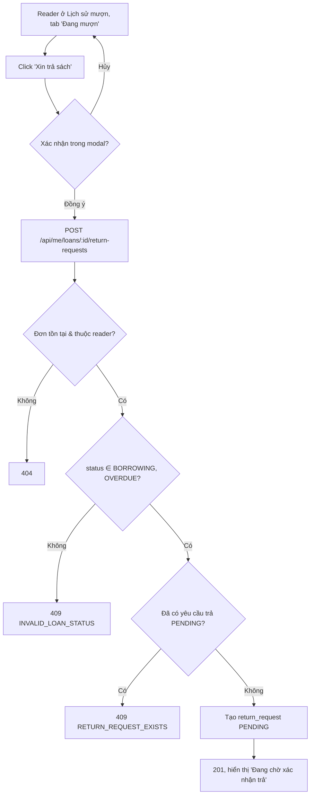

# 2.4.1 Yêu cầu trả sách

## 1. Tổng quan
- **Actor:** Độc giả
- **Điều kiện tiên quyết:** Đã đăng nhập Reader; có đơn `BORROWING` hoặc `OVERDUE`
- **Kết quả:** Tạo yêu cầu trả trạng thái `PENDING` ("Chờ xác nhận"). Độc giả mang sách đến thư viện để nhân viên xác nhận (2.4.2).

## 2. Validation rules
| Tham số | Quy tắc | Nguồn |
|---------|---------|-------|
| `:loanId` | UUID, đơn thuộc người gọi | Giả định |

## 3. Quy tắc nghiệp vụ
- BR-01: Đơn phải ở trạng thái `BORROWING` hoặc `OVERDUE` → khác: `409 INVALID_LOAN_STATUS`.
- BR-02: Mỗi đơn chỉ có **một** yêu cầu trả `PENDING` → đã có: `409 RETURN_REQUEST_EXISTS`. Ràng buộc được đảm bảo ở DB bằng partial unique index `(loan_id) WHERE status = 'PENDING'`; vi phạm unique (P2002) được ánh xạ sang 409.
- BR-03: Tạo yêu cầu **không** đổi trạng thái đơn mượn và **không** đổi số lượng sách.
- BR-04: FE hiển thị modal "Xác nhận gửi yêu cầu trả sách *Tên sách*? Vui lòng mang sách đến thư viện." Sau khi gửi, nút "Xin trả sách" chuyển thành nhãn "Đang chờ xác nhận trả".

## 4. Flowchart


## 5. Test cases
### Happy cases
| Mã | Mô tả | Kết quả mong đợi |
|----|-------|------------------|
| HC-01 | Gửi yêu cầu trả cho đơn `BORROWING` | 201, yêu cầu `PENDING`; đơn vẫn `BORROWING`; số lượng sách không đổi |
| HC-02 | Gửi yêu cầu trả cho đơn `OVERDUE` | 201 |
| HC-03 | Sau khi gửi, `GET /api/me/loans` | `hasPendingReturn = true`, `canRequestReturn = false`, `canExtend = false` |
| HC-04 | Yêu cầu xuất hiện ở tab "Chờ xác nhận trả" của Staff | Có |

### Edge cases
| Mã | Mô tả | Kết quả mong đợi |
|----|-------|------------------|
| EC-01 | Gửi yêu cầu lần 2 khi yêu cầu trước còn `PENDING` | 409 `RETURN_REQUEST_EXISTS` |
| EC-02 | Hai request song song cho cùng đơn | 1 thành công (201), 1 nhận 409 |
| EC-03 | Đơn `PENDING` / `RETURNED` / `REJECTED` | 409 `INVALID_LOAN_STATUS` |
| EC-04 | Đơn của reader khác | 404 |
| EC-05 | Đơn không tồn tại | 404 |
| EC-06 | Bấm "Hủy" trong modal | Không gọi API |
| EC-07 | Staff gọi API | 403 |

## 6. API
### `POST /api/me/loans/:id/return-requests`
- **Quyền:** `READER` (chủ đơn) — **Request:** không có body
- **Response 201:**
  ```json
  { "data": { "id": "uuid", "loanId": "uuid", "status": "PENDING", "requestedAt": "..." } }
  ```
- **Lỗi:** `401`, `403`, `404`, `409 INVALID_LOAN_STATUS`, `409 RETURN_REQUEST_EXISTS`

## 7. Giả định / câu hỏi mở
- PRD không có chức năng nhân viên "từ chối" yêu cầu trả hoặc độc giả hủy yêu cầu → yêu cầu trả chỉ có 2 trạng thái `PENDING`, `CONFIRMED`.
