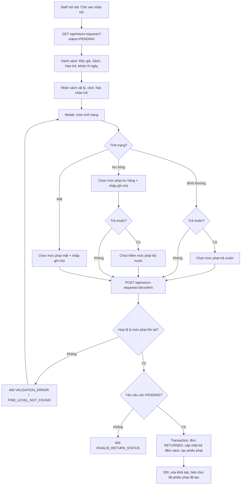

# 2.4.2 Xác nhận trả sách

## 1. Tổng quan
- **Actor:** Staff
- **Điều kiện tiên quyết:** Đã đăng nhập Staff; có yêu cầu trả `PENDING` (2.4.1); đã có mức phạt (2.5.1) nếu cần phạt
- **Kết quả:** Đơn mượn `RETURNED`; cập nhật bộ đếm sách theo tình trạng; tạo phiếu phạt (hư hỏng / mất / trả muộn) nếu có.

## 2. Validation rules
| Trường | Quy tắc | Nguồn |
|--------|---------|-------|
| `condition` | Bắt buộc: `NORMAL` \| `DAMAGED` \| `LOST` | PRD 2.4.2 |
| `fineLevelId` | Bắt buộc khi `condition ∈ {DAMAGED, LOST}`; phải tồn tại trong `fine_levels`; bị bỏ qua khi `NORMAL` | PRD 2.4.2 |
| `lateFineLevelId` | Bắt buộc khi **trả muộn** và `condition ∈ {NORMAL, DAMAGED}`; phải tồn tại; bị bỏ qua khi không muộn hoặc `LOST` | PRD 2.4.2 / Giả định (LOST) |
| `note` | Bắt buộc khi `condition ∈ {DAMAGED, LOST}`; không bắt buộc khi `NORMAL`; tối đa 500 ký tự | PRD 2.4.2 |

## 3. Quy tắc nghiệp vụ
- BR-01: **Trả muộn** khi `today_vn > due_date`. Số ngày muộn = `today_vn − due_date`. BE tính, **không** nhận từ client. Danh sách yêu cầu trả hiển thị sẵn `isLate`, `lateDays` để FE bật trường "Mức phạt trả muộn".
- BR-02: Chỉ xử lý yêu cầu `PENDING` → khác: `409 INVALID_RETURN_STATUS`.
- BR-03: Toàn bộ chạy trong một transaction, khóa dòng `return_requests`, `loans`, `books` (`FOR UPDATE`):
  | Tình trạng | Đơn mượn | Sách | Phiếu phạt tạo ra |
  |------------|----------|------|-------------------|
  | `NORMAL` | `RETURNED` | `available +1`, `borrowed −1` | `LATE` nếu muộn |
  | `DAMAGED` | `RETURNED` | `borrowed −1`, `damaged +1` (không về kho) | `DAMAGED` + `LATE` nếu muộn |
  | `LOST` | `RETURNED` | `borrowed −1`, `lost +1` | `LOST` |
- BR-04: Đơn mượn: `status = RETURNED`, `returned_at = now()`, `return_condition = condition`. Yêu cầu trả: `status = CONFIRMED`, `condition`, `note`, `confirmed_by`, `confirmed_at`.
- BR-05: Phiếu phạt lưu **snapshot** `fine_level_name`, `amount` từ mức phạt tại thời điểm tạo (sửa/xóa mức phạt sau đó không ảnh hưởng phiếu). `status = UNPAID`, `fine_date = today_vn`, `user_id` = độc giả của đơn, `note` = ghi chú (phiếu `LATE`: `"Trả muộn N ngày"`).
- BR-06: Mỗi đơn có tối đa 1 phiếu cho mỗi lý do (unique `(loan_id, reason)`).
- BR-07: Nếu chưa có mức phạt nào mà cần phạt → FE hiển thị "Chưa có mức phạt, liên hệ Quản lý viên" và không cho gửi.

## 4. Flowchart


## 5. Test cases
### Happy cases
| Mã | Mô tả | Kết quả mong đợi |
|----|-------|------------------|
| HC-01 | Xem danh sách yêu cầu `PENDING` có 1 đơn muộn 3 ngày | Dòng đó `isLate = true`, `lateDays = 3` |
| HC-02 | `NORMAL`, không muộn | Đơn `RETURNED`; sách `available +1`, `borrowed −1`; không tạo phiếu phạt |
| HC-03 | `NORMAL`, muộn, có `lateFineLevelId` | Như HC-02 + 1 phiếu `LATE` `UNPAID` với số tiền = mức phạt |
| HC-04 | `DAMAGED`, không muộn, có mức phạt + ghi chú | Đơn `RETURNED`; sách `borrowed −1`, `damaged +1`, `available` không đổi; 1 phiếu `DAMAGED` |
| HC-05 | `DAMAGED`, muộn | 2 phiếu: `DAMAGED` + `LATE` |
| HC-06 | `LOST`, có mức phạt + ghi chú | Đơn `RETURNED`; sách `borrowed −1`, `lost +1`; 1 phiếu `LOST` |
| HC-07 | `LOST`, muộn, không gửi `lateFineLevelId` | 200; chỉ 1 phiếu `LOST` |
| HC-08 | Trả đúng ngày hạn (`today = due_date`) | Không tính muộn |
| HC-09 | Sau khi trả, sửa số tiền mức phạt | Số tiền phiếu đã tạo không đổi |
| HC-10 | Bất biến `total = available + borrowed + damaged + lost` sau mỗi case | Luôn đúng |
| HC-11 | Reader xem lịch sử mượn | Đơn ở tab "Đã trả" có ngày trả; phiếu phạt xuất hiện ở 2.5.2 |

### Edge cases
| Mã | Mô tả | Kết quả mong đợi |
|----|-------|------------------|
| EC-01 | Không gửi `condition` / giá trị lạ | 400 |
| EC-02 | `DAMAGED` thiếu `fineLevelId` | 400 `fineLevelId` |
| EC-03 | `DAMAGED` thiếu `note` | 400 `note` |
| EC-04 | `LOST` thiếu `fineLevelId` hoặc `note` | 400 |
| EC-05 | `note` 501 ký tự | 400 |
| EC-06 | `NORMAL` + muộn, thiếu `lateFineLevelId` | 400 `lateFineLevelId` |
| EC-07 | `DAMAGED` + muộn, thiếu `lateFineLevelId` | 400 `lateFineLevelId` |
| EC-08 | `NORMAL` không muộn nhưng gửi `fineLevelId`, `lateFineLevelId` | 200, bị bỏ qua, không tạo phiếu |
| EC-09 | `fineLevelId` không tồn tại | 400 `FINE_LEVEL_NOT_FOUND` |
| EC-10 | Xác nhận yêu cầu đã `CONFIRMED` | 409 `INVALID_RETURN_STATUS` |
| EC-11 | Hai nhân viên xác nhận cùng lúc | 1 thành công, 1 nhận 409; bộ đếm sách chỉ đổi 1 lần |
| EC-12 | Lỗi khi tạo phiếu phạt giữa chừng | Rollback toàn bộ, đơn vẫn `BORROWING/OVERDUE`, yêu cầu vẫn `PENDING` |
| EC-13 | Yêu cầu không tồn tại | 404 |
| EC-14 | Reader gọi API | 403 |

## 6. API
### `GET /api/return-requests`
- **Quyền:** Staff
- **Query:** `status` (mặc định `PENDING`), `q` (tên/email độc giả, tên sách), `page`, `limit`
- **Response 200:**
  ```json
  { "data": [ { "id": "uuid", "status": "PENDING", "requestedAt": "...",
                "loan": { "id": "uuid", "borrowDate": "2026-10-01", "dueDate": "2026-10-15", "status": "OVERDUE" },
                "reader": { "id": "uuid", "name": "...", "email": "..." },
                "book": { "id": "uuid", "title": "..." },
                "isLate": true, "lateDays": 3 } ],
    "meta": { ... } }
  ```

### `POST /api/return-requests/:id/confirm`
- **Quyền:** Staff
- **Request:**
  ```json
  { "condition": "DAMAGED", "fineLevelId": 2, "lateFineLevelId": 1, "note": "Rách bìa, ố 10 trang" }
  ```
- **Response 200:**
  ```json
  { "data": { "returnRequest": { "id": "uuid", "status": "CONFIRMED", "condition": "DAMAGED" },
              "loan": { "id": "uuid", "status": "RETURNED", "returnedAt": "..." },
              "fines": [ { "id": "uuid", "reason": "DAMAGED", "amount": 50000, "status": "UNPAID" },
                         { "id": "uuid", "reason": "LATE", "amount": 10000, "status": "UNPAID" } ] } }
  ```
- **Lỗi:** `400 VALIDATION_ERROR`, `400 FINE_LEVEL_NOT_FOUND`, `401`, `403`, `404`, `409 INVALID_RETURN_STATUS`

## 7. Giả định / câu hỏi mở
- Sách **mất** không tạo thêm phiếu trả muộn (PRD chỉ nêu phạt muộn ở nhánh hư hỏng; phạt mất đã bao gồm). Nhánh **bình thường** vẫn tạo phiếu muộn vì PRD ghi "mức phạt bắt buộc khi trả muộn".
- Phạt trả muộn là một mức phạt cố định do nhân viên chọn (không nhân theo số ngày) — đúng theo PRD "chọn mức phạt từ danh sách".
