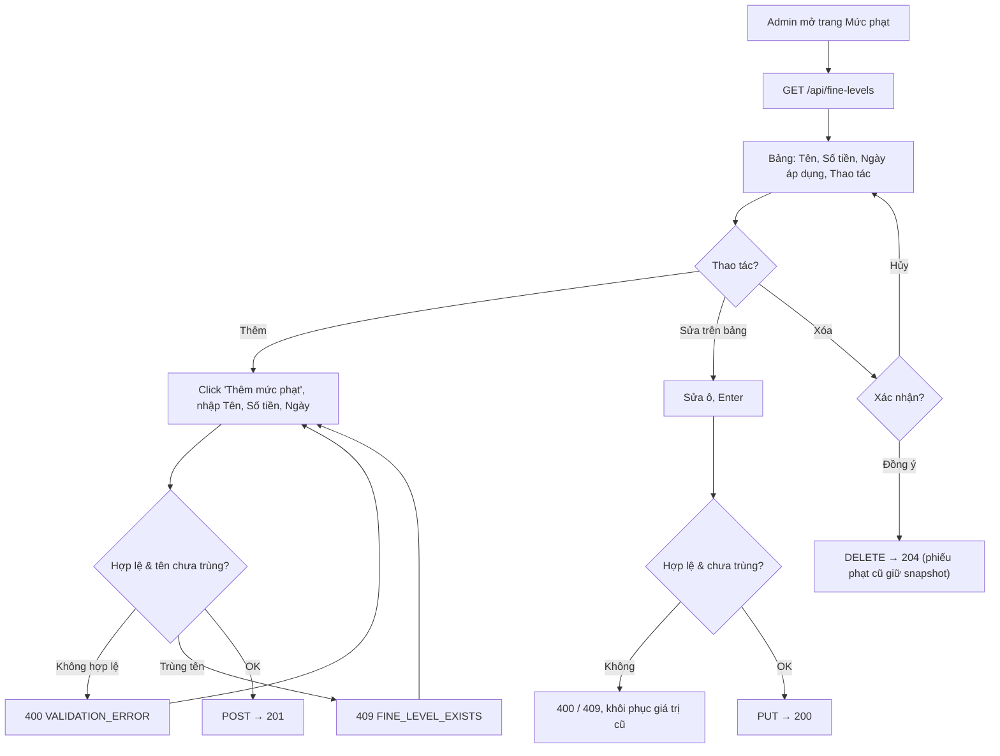

# 2.5.1 Quản lý mức phạt

## 1. Tổng quan
- **Actor:** Quản lý viên (`ADMIN`) — Staff chỉ được **đọc** danh sách (để chọn khi xác nhận trả 2.4.2)
- **Điều kiện tiên quyết:** Đã đăng nhập Admin
- **Kết quả:** Xem / thêm / sửa trực tiếp trên bảng / xóa mức phạt.

## 2. Validation rules
| Trường | Quy tắc | Nguồn |
|--------|---------|-------|
| `name` | Bắt buộc (sau trim), tối đa 25 ký tự, duy nhất (không phân biệt hoa thường) | PRD 2.5.1 / Giả định (duy nhất) |
| `amount` | Bắt buộc, số nguyên > 0 (VND), tối đa 100.000.000 | PRD 2.5.1 / Giả định (nguyên, max) |
| `appliedDate` ("Ngày phạt") | Ngày hợp lệ `YYYY-MM-DD`, mặc định hôm nay (VN) | PRD 2.5.1 |

## 3. Quy tắc nghiệp vụ
- BR-01: "Ngày phạt" trong PRD được hiểu là **ngày áp dụng** của mức phạt (lưu `applied_date`), chỉ để hiển thị/tham khảo. Ngày của từng phiếu phạt là `fines.fine_date` (2.4.2).
- BR-02: Phiếu phạt lưu snapshot tên + số tiền, nên **sửa** mức phạt không thay đổi phiếu đã tạo.
- BR-03: **Xóa** cho phép ngay cả khi đã có phiếu phạt dùng mức này: `fines.fine_level_id` → `NULL` (FK `ON DELETE SET NULL`), snapshot vẫn còn.
- BR-04: FE hiển thị modal xác nhận trước khi xóa; sửa trên bảng giống 2.2.1 BR-04.
- BR-05: Mức phạt dùng chung cho cả 3 lý do (hư hỏng / mất / trả muộn); Admin đặt tên gợi nhớ (ví dụ "Trả muộn", "Hư hỏng nhẹ", "Mất sách").

## 4. Flowchart

## 5. Test cases
### Happy cases
| Mã | Mô tả | Kết quả mong đợi |
|----|-------|------------------|
| HC-01 | Admin xem danh sách | 200 |
| HC-02 | Librarian xem danh sách (GET) | 200 |
| HC-03 | Thêm mức phạt không gửi `appliedDate` | 201, `appliedDate = hôm nay` |
| HC-04 | Thêm với tên 25 ký tự, `amount = 1` (biên) | 201 |
| HC-05 | Sửa số tiền trên bảng | 200; phiếu phạt đã tạo trước đó giữ số tiền cũ |
| HC-06 | Xóa mức phạt chưa dùng | 204 |
| HC-07 | Xóa mức phạt đã được dùng trong phiếu | 204; phiếu cũ vẫn hiển thị tên + số tiền snapshot |

### Edge cases
| Mã | Mô tả | Kết quả mong đợi |
|----|-------|------------------|
| EC-01 | Tên rỗng / 26 ký tự | 400 |
| EC-02 | Tên trùng (khác hoa thường) | 409 `FINE_LEVEL_EXISTS` |
| EC-03 | `amount` = 0 / âm / 1.5 / `"abc"` | 400 |
| EC-04 | `appliedDate` = `2026-02-30` / `abc` | 400 |
| EC-05 | Librarian gọi POST/PUT/DELETE | 403 |
| EC-06 | Reader gọi GET | 403 |
| EC-07 | Sửa/xóa id không tồn tại | 404 |
| EC-08 | Bấm "Hủy" trong modal xóa | Không gọi API |

## 6. API
### `GET /api/fine-levels`
- **Quyền:** Staff (`LIBRARIAN | ADMIN`)
- **Response 200:** `{ "data": [ { "id": 1, "name": "Trả muộn", "amount": 10000, "appliedDate": "2026-10-29" } ] }`

### `POST /api/fine-levels`
- **Quyền:** `ADMIN` — **Request:** `{ "name": "Trả muộn", "amount": 10000, "appliedDate": "2026-10-29" }` — **Response 201**
- **Lỗi:** `400`, `401`, `403`, `409 FINE_LEVEL_EXISTS`

### `PUT /api/fine-levels/:id`
- **Quyền:** `ADMIN` — **Request:** như POST — **Response 200**
- **Lỗi:** `400`, `401`, `403`, `404`, `409 FINE_LEVEL_EXISTS`

### `DELETE /api/fine-levels/:id`
- **Quyền:** `ADMIN` — **Response 204**
- **Lỗi:** `401`, `403`, `404`

## 7. Giả định / câu hỏi mở
- Ý nghĩa "Ngày phạt" của một mức phạt chưa rõ trong PRD → hiểu là ngày áp dụng (BR-01). Cần xác nhận.
