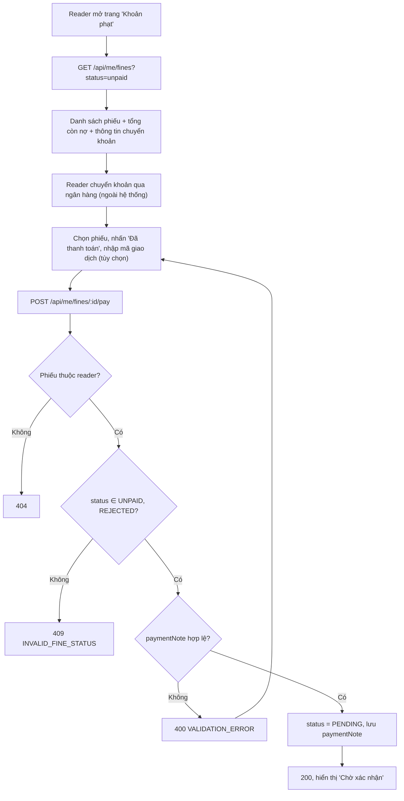

# 2.5.2 Xem & thanh toán khoản phạt (Độc giả)

## 1. Tổng quan
- **Actor:** Độc giả
- **Điều kiện tiên quyết:** Đã đăng nhập Reader; có phiếu phạt (tạo ở 2.4.2)
- **Kết quả:** Xem phiếu phạt; báo đã chuyển khoản → phiếu chuyển sang `PENDING` ("Chờ xác nhận").

## 2. Validation rules
| Trường | Quy tắc | Nguồn |
|--------|---------|-------|
| `status` (query) | Không bắt buộc; `UNPAID`, `PENDING`, `REJECTED`, `PAID`, hoặc `unpaid` (nhóm 3 trạng thái chưa thanh toán — mặc định) | PRD 2.5.2 |
| `paymentNote` | Không bắt buộc, tối đa 255 ký tự (mã giao dịch / ghi chú chuyển khoản) | Giả định |

## 3. Quy tắc nghiệp vụ
- BR-01: Mặc định hiển thị phiếu **chưa thanh toán** (`UNPAID | PENDING | REJECTED`); có tab "Đã thanh toán" (`PAID`).
- BR-02: Cột hiển thị: Nguyên nhân (Trả muộn / Hư hỏng / Mất + tên sách + ghi chú), Số tiền, Ngày phạt, Trạng thái; phiếu `REJECTED` hiển thị thêm **lý do từ chối**.
- BR-03: Chỉ phiếu `UNPAID` hoặc `REJECTED` được nhấn "Đã thanh toán" → khác: `409 INVALID_FINE_STATUS`.
- BR-04: Nhấn "Đã thanh toán": `status = PENDING`, `payment_note`, `payment_requested_at = now()`; xóa `reject_reason` cũ (lịch sử từ chối không cần lưu — giả định).
- BR-05: Trang hiển thị thông tin chuyển khoản (ngân hàng, số tài khoản, chủ tài khoản) lấy từ cấu hình BE (env `BANK_NAME`, `BANK_ACCOUNT_NO`, `BANK_ACCOUNT_NAME`) và nội dung chuyển khoản gợi ý `PHAT <mã phiếu>` (`fines.code`).
- BR-06: Hiển thị tổng tiền còn nợ ở đầu trang.
- BR-07: Phiếu của người khác → `404`.

## 4. Flowchart


## 5. Test cases
### Happy cases
| Mã | Mô tả | Kết quả mong đợi |
|----|-------|------------------|
| HC-01 | Xem mặc định khi có phiếu ở cả 4 trạng thái | Chỉ trả `UNPAID`, `PENDING`, `REJECTED`; có `summary.unpaidTotal` |
| HC-02 | `status=PAID` | Chỉ phiếu đã thanh toán |
| HC-03 | Báo đã thanh toán phiếu `UNPAID` | 200, `status = PENDING` |
| HC-04 | Báo lại phiếu `REJECTED` | 200, `status = PENDING`, `rejectReason = null` |
| HC-05 | Kèm `paymentNote` | Được lưu |
| HC-06 | Phiếu `REJECTED` hiển thị lý do từ chối | Có `rejectReason` |
| HC-07 | Response có thông tin chuyển khoản | Có `paymentInfo` |

### Edge cases
| Mã | Mô tả | Kết quả mong đợi |
|----|-------|------------------|
| EC-01 | Báo thanh toán phiếu `PENDING` | 409 `INVALID_FINE_STATUS` |
| EC-02 | Báo thanh toán phiếu `PAID` | 409 `INVALID_FINE_STATUS` |
| EC-03 | Phiếu của reader khác | 404 |
| EC-04 | `paymentNote` 256 ký tự | 400 |
| EC-05 | Sau khi báo thanh toán, reader thử mượn sách | Vẫn 422 `HAS_UNPAID_FINES` (phiếu `PENDING` tính chưa thanh toán) |
| EC-06 | Reader không có phiếu nào | `data: []`, `unpaidTotal = 0`, FE hiển thị "Bạn không có khoản phạt nào" |
| EC-07 | Staff gọi `/api/me/fines` | 403 |

## 6. API
### `GET /api/me/fines`
- **Quyền:** `READER`
- **Query:** `status`, `page`, `limit`
- **Response 200:**
  ```json
  { "data": [ { "id": "uuid", "code": "F000123", "reason": "LATE", "fineLevelName": "Trả muộn", "amount": 10000,
                "fineDate": "2026-10-29", "status": "REJECTED", "note": "Trả muộn 3 ngày",
                "rejectReason": "Số tiền chuyển chưa đủ", "paymentNote": null,
                "book": { "id": "uuid", "title": "..." }, "loanId": "uuid" } ],
    "meta": { "page": 1, "limit": 10, "total": 1, "totalPages": 1,
              "summary": { "unpaidTotal": 10000 },
              "paymentInfo": { "bankName": "...", "accountNo": "...", "accountName": "..." } } }
  ```

### `POST /api/me/fines/:id/pay`
- **Quyền:** `READER` (chủ phiếu) — **Request:** `{ "paymentNote": "FT2630212345" }` (tùy chọn)
- **Response 200:** phiếu đã cập nhật
- **Lỗi:** `400`, `401`, `403`, `404`, `409 INVALID_FINE_STATUS`

## 7. Giả định / câu hỏi mở
- Không upload ảnh biên lai (PRD không yêu cầu). Có thể bổ sung bằng Supabase Storage nếu cần.
- Không lưu lịch sử các lần từ chối (chỉ lưu lý do lần gần nhất).
