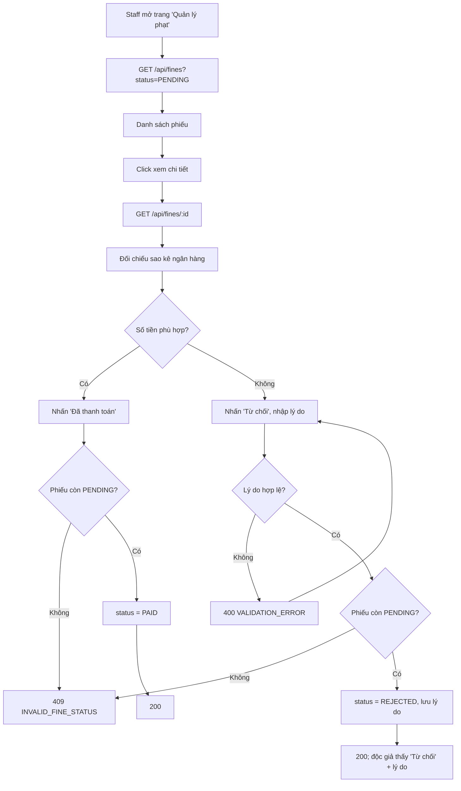

# 2.5.3 Xem & xác nhận thanh toán phạt (Nhân viên)

## 1. Tổng quan
- **Actor:** Staff
- **Điều kiện tiên quyết:** Đã đăng nhập Staff; có phiếu phạt `PENDING` (2.5.2)
- **Kết quả:** Xác nhận → `PAID`; Từ chối → `REJECTED` kèm lý do (vẫn tính là chưa thanh toán).

## 2. Validation rules
| Trường | Quy tắc | Nguồn |
|--------|---------|-------|
| `reason` (từ chối) | Bắt buộc (sau trim), tối đa 255 ký tự | PRD 2.5.3 / Giả định (max) |
| `status` (query) | `UNPAID`, `PENDING`, `REJECTED`, `PAID`, `unpaid` (mặc định) | PRD 2.5.3 |

## 3. Quy tắc nghiệp vụ
- BR-01: Danh sách mặc định là phiếu chưa thanh toán (`UNPAID | PENDING | REJECTED`), có tab riêng "Chờ xác nhận" (`PENDING`) và "Đã thanh toán". Tìm theo tên/email độc giả hoặc mã phiếu.
- BR-02: Chi tiết phiếu: mã, độc giả, sách, lý do, tên mức phạt, số tiền, ngày phạt, ghi chú, mã giao dịch, thời điểm báo thanh toán, lý do từ chối (nếu có), người xác nhận.
- BR-03: Chỉ xác nhận / từ chối phiếu `PENDING` → khác: `409 INVALID_FINE_STATUS`.
- BR-04 (Xác nhận): `status = PAID`, `confirmed_by`, `paid_at = now()`.
- BR-05 (Từ chối): `status = REJECTED`, `reject_reason`, `confirmed_by`, `rejected_at = now()`. Độc giả có thể báo thanh toán lại (2.5.2 HC-04).
- BR-06: Cập nhật có điều kiện `WHERE status = 'PENDING'` để tránh xử lý trùng.

## 4. Flowchart

## 5. Test cases
### Happy cases
| Mã | Mô tả | Kết quả mong đợi |
|----|-------|------------------|
| HC-01 | Xem danh sách mặc định | Chỉ phiếu `UNPAID`, `PENDING`, `REJECTED` |
| HC-02 | Lọc `status=PENDING` | Chỉ phiếu chờ xác nhận |
| HC-03 | Xem chi tiết phiếu | 200, đủ trường BR-02 |
| HC-04 | Xác nhận phiếu `PENDING` | 200, `PAID`, có `paidAt`, `confirmedBy` |
| HC-05 | Sau khi tất cả phiếu `PAID`, reader mượn sách | Không còn bị chặn bởi `HAS_UNPAID_FINES` |
| HC-06 | Từ chối với lý do | 200, `REJECTED`, `rejectReason` được lưu |
| HC-07 | Reader báo lại → Staff xác nhận | Chu trình `REJECTED → PENDING → PAID` thành công |
| HC-08 | Tìm theo mã phiếu | Đúng phiếu |

### Edge cases
| Mã | Mô tả | Kết quả mong đợi |
|----|-------|------------------|
| EC-01 | Xác nhận phiếu `UNPAID` (reader chưa báo) | 409 `INVALID_FINE_STATUS` |
| EC-02 | Xác nhận phiếu `PAID` / `REJECTED` | 409 |
| EC-03 | Từ chối không có lý do / 256 ký tự | 400 |
| EC-04 | Hai nhân viên xử lý cùng phiếu đồng thời | 1 thành công, 1 nhận 409 |
| EC-05 | Phiếu không tồn tại | 404 |
| EC-06 | Reader gọi `/api/fines` | 403 |

## 6. API
### `GET /api/fines`
- **Quyền:** Staff — **Query:** `status`, `q`, `page`, `limit`
- **Response 200:** danh sách phiếu (shape như 2.5.2 + `reader: { id, name, email }`)

### `GET /api/fines/:id`
- **Quyền:** Staff — **Response 200:** chi tiết phiếu (BR-02) — **Lỗi:** `404`

### `POST /api/fines/:id/confirm`
- **Quyền:** Staff — **Request:** không có body — **Response 200:** phiếu đã cập nhật
- **Lỗi:** `401`, `403`, `404`, `409 INVALID_FINE_STATUS`

### `POST /api/fines/:id/reject`
- **Quyền:** Staff — **Request:** `{ "reason": "Số tiền chuyển chưa đủ" }` — **Response 200**
- **Lỗi:** `400`, `401`, `403`, `404`, `409 INVALID_FINE_STATUS`

## 7. Giả định / câu hỏi mở
- Nhân viên không tạo / sửa / hủy phiếu phạt thủ công (PRD không yêu cầu).
- Staff có thể xác nhận thu tiền mặt tại quầy? PRD chỉ nêu chuyển khoản → không làm.
