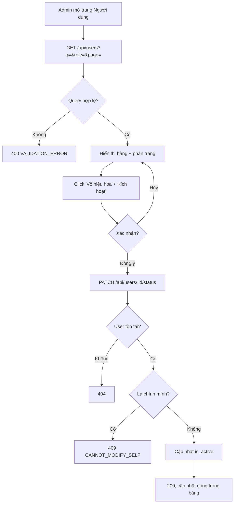

# 2.6.1 Danh sách người dùng

## 1. Tổng quan
- **Actor:** Quản lý viên (`ADMIN`)
- **Điều kiện tiên quyết:** Đã đăng nhập Admin
- **Kết quả:** Xem danh sách người dùng; tìm kiếm, lọc; kích hoạt / vô hiệu hóa tài khoản.

## 2. Validation rules
| Tham số | Quy tắc | Nguồn |
|---------|---------|-------|
| `q` | Không bắt buộc, tối đa 100 ký tự; tìm trong `email` **hoặc** `name` (ILIKE) | PRD 2.6.1 |
| `role` | Không bắt buộc; `READER` \| `LIBRARIAN` \| `ADMIN` | PRD 2.6.1 |
| `isActive` | Không bắt buộc; `true` \| `false` | Giả định |
| `isActive` (body) | Bắt buộc, boolean | PRD 2.6.1 |

## 3. Quy tắc nghiệp vụ
- BR-01: Cột: Email, Tên, Vai trò, Ngày tham gia, Trạng thái (Kích hoạt / Vô hiệu hóa). Sắp xếp mới nhất trước, 10/trang.
- BR-02: Admin **không** vô hiệu hóa được chính mình → `409 CANNOT_MODIFY_SELF` (tránh tự khóa, luôn còn ít nhất 1 admin hoạt động).
- BR-03: Tài khoản bị vô hiệu hóa: không đăng nhập được (2.1.2 EC-05) và mọi token hiện có bị từ chối ngay (middleware đọc DB — xem quy ước chung).
- BR-04: Vô hiệu hóa không ảnh hưởng dữ liệu hiện có (đơn mượn, phiếu phạt giữ nguyên); Staff vẫn xử lý trả sách / phạt của tài khoản đó bình thường.
- BR-05: Đặt `is_active` bằng giá trị hiện tại → 200 (idempotent).
- BR-06: FE hiển thị modal xác nhận trước khi vô hiệu hóa.

## 4. Flowchart


## 5. Test cases
### Happy cases
| Mã | Mô tả | Kết quả mong đợi |
|----|-------|------------------|
| HC-01 | Xem danh sách | 200, đủ cột BR-01, không chứa `passwordHash` |
| HC-02 | Tìm theo một phần email | Đúng kết quả |
| HC-03 | Tìm theo tên, khác hoa thường | Đúng kết quả |
| HC-04 | Lọc `role=LIBRARIAN` | Chỉ librarian |
| HC-05 | Vô hiệu hóa reader | 200, `isActive=false`; reader đó đăng nhập → 403 `ACCOUNT_DISABLED` |
| HC-06 | Reader đang có token bị vô hiệu hóa, gọi API | 401 |
| HC-07 | Kích hoạt lại | 200; đăng nhập lại được |

### Edge cases
| Mã | Mô tả | Kết quả mong đợi |
|----|-------|------------------|
| EC-01 | Admin vô hiệu hóa chính mình | 409 `CANNOT_MODIFY_SELF` |
| EC-02 | `role=abc` | 400 |
| EC-03 | Body `isActive` thiếu / không phải boolean | 400 |
| EC-04 | User không tồn tại | 404 |
| EC-05 | Librarian / Reader gọi API | 403 |
| EC-06 | `q` không khớp | `data: []` |

## 6. API
### `GET /api/users`
- **Quyền:** `ADMIN` — **Query:** `q`, `role`, `isActive`, `page`, `limit`
- **Response 200:**
  ```json
  { "data": [ { "id": "uuid", "email": "...", "name": "...", "role": "READER", "isActive": true, "createdAt": "..." } ],
    "meta": { ... } }
  ```

### `PATCH /api/users/:id/status`
- **Quyền:** `ADMIN` — **Request:** `{ "isActive": false }` — **Response 200:** user đã cập nhật
- **Lỗi:** `400`, `401`, `403`, `404`, `409 CANNOT_MODIFY_SELF`
