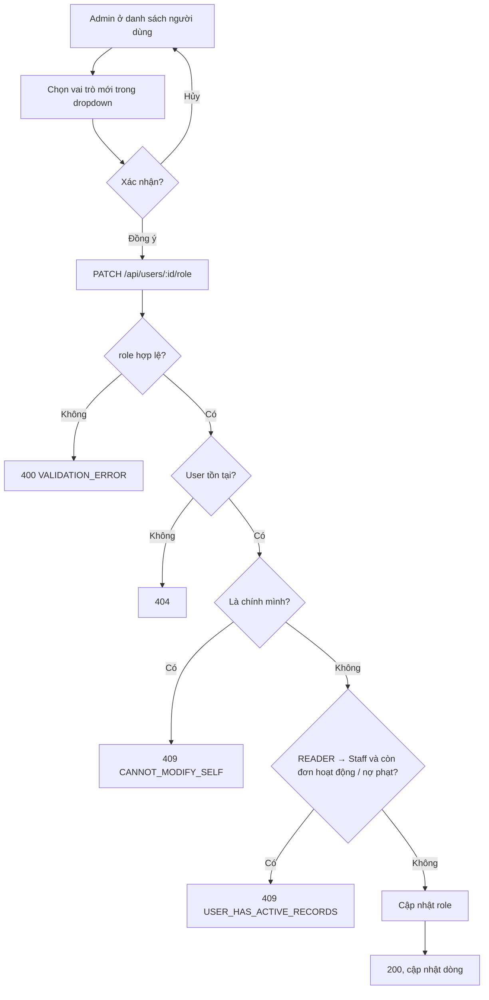

# 2.6.2 Gán vai trò

## 1. Tổng quan
- **Actor:** Quản lý viên (`ADMIN`)
- **Điều kiện tiên quyết:** Đã đăng nhập Admin; đang ở danh sách người dùng (2.6.1)
- **Kết quả:** Đổi vai trò của một người dùng sang `READER` / `LIBRARIAN` / `ADMIN`.

## 2. Validation rules
| Trường | Quy tắc | Nguồn |
|--------|---------|-------|
| `role` | Bắt buộc; `READER` \| `LIBRARIAN` \| `ADMIN` | PRD 2.6.2 |

## 3. Quy tắc nghiệp vụ
- BR-01: Ma trận quyền:
  | Chức năng | READER | LIBRARIAN | ADMIN |
  |-----------|:------:|:---------:|:-----:|
  | Xem sách, chi tiết sách | ✔ | ✔ | ✔ |
  | Hồ sơ, đổi mật khẩu | ✔ | ✔ | ✔ |
  | Mượn, gia hạn, xin trả, thanh toán phạt | ✔ | | |
  | Thể loại, thêm/sửa/xóa sách | | ✔ | ✔ |
  | Xác nhận mượn/trả, xác nhận phạt | | ✔ | ✔ |
  | Xem mức phạt | | ✔ | ✔ |
  | Thêm/sửa/xóa mức phạt | | | ✔ |
  | Quản lý người dùng, gán vai trò | | | ✔ |
  | Dashboard, báo cáo | | ✔ | ✔ |
- BR-02: Admin **không** đổi vai trò của chính mình → `409 CANNOT_MODIFY_SELF`.
- BR-03: Hạ vai trò từ `READER` sang Staff khi người đó còn đơn hoạt động (`PENDING | BORROWING | OVERDUE`) hoặc phiếu phạt chưa thanh toán → `409 USER_HAS_ACTIVE_RECORDS` *(giả định — tránh dữ liệu mồ côi vì Staff không dùng được các chức năng của Reader)*.
- BR-04: Thay đổi có hiệu lực ngay ở request kế tiếp (middleware lấy role từ DB). FE của người bị đổi nhận 403 → gọi lại `/api/auth/me` để làm mới menu.
- BR-05: Gán đúng vai trò hiện tại → 200 (idempotent).
- BR-06: FE: dropdown vai trò trên mỗi dòng bảng + modal xác nhận.

## 4. Flowchart

## 5. Test cases
### Happy cases
| Mã | Mô tả | Kết quả mong đợi |
|----|-------|------------------|
| HC-01 | Đổi reader (không có đơn/phạt) → `LIBRARIAN` | 200; người đó gọi được API Staff, gọi API Reader → 403 |
| HC-02 | Đổi librarian → `ADMIN` | 200; gọi được `/api/users` |
| HC-03 | Đổi librarian → `READER` | 200; gọi API Staff → 403 |
| HC-04 | Đổi sang đúng vai trò hiện tại | 200 |
| HC-05 | Kiểm tra từng ô của ma trận BR-01 | Mỗi ô ✔ trả 2xx, ô trống trả 403 |

### Edge cases
| Mã | Mô tả | Kết quả mong đợi |
|----|-------|------------------|
| EC-01 | `role=SUPERADMIN` / thiếu `role` | 400 |
| EC-02 | Admin đổi vai trò chính mình | 409 `CANNOT_MODIFY_SELF` |
| EC-03 | Reader còn đơn `BORROWING` → `LIBRARIAN` | 409 `USER_HAS_ACTIVE_RECORDS` |
| EC-04 | Reader còn phiếu `UNPAID` → `ADMIN` | 409 `USER_HAS_ACTIVE_RECORDS` |
| EC-05 | User không tồn tại | 404 |
| EC-06 | Librarian gọi API | 403 |
| EC-07 | Token cũ của user bị hạ quyền gọi API Staff | 403 |

## 6. API
### `PATCH /api/users/:id/role`
- **Quyền:** `ADMIN` — **Request:** `{ "role": "LIBRARIAN" }` — **Response 200:** user đã cập nhật
- **Lỗi:** `400`, `401`, `403`, `404`, `409 CANNOT_MODIFY_SELF`, `409 USER_HAS_ACTIVE_RECORDS`

## 7. Giả định / câu hỏi mở
- BR-03 không có trong PRD — cần xác nhận.
- Tài khoản Admin/Librarian đầu tiên được tạo bằng seed (task 3.0.6).
