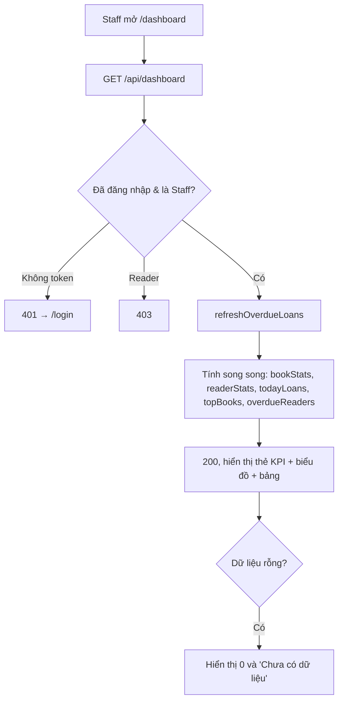

# 2.7.1 Báo cáo tổng quan (Dashboard)

## 1. Tổng quan
- **Actor:** Staff (`LIBRARIAN | ADMIN`)
- **Điều kiện tiên quyết:** Đã đăng nhập Staff
- **Kết quả:** Một trang tổng quan với số liệu thời gian thực (tại thời điểm tải).

## 2. Validation rules
Không có input.

## 3. Quy tắc nghiệp vụ
Gọi `refreshOverdueLoans()` trước khi tính. Chỉ tính sách chưa xóa mềm.
- BR-01 **Tổng số sách** (tính theo bản): `SUM(total_quantity)`, chia thành Có sẵn `SUM(available_quantity)` / Đang mượn `SUM(borrowed_quantity)` / Bị mất `SUM(lost_quantity)` / Hư hỏng `SUM(damaged_quantity)`. Kèm số đầu sách `COUNT(*)`.
- BR-02 **Tổng số độc giả** (`role = READER`): Hoạt động (`is_active = true`) / Vô hiệu hóa.
- BR-03 **Tổng đơn mượn hôm nay**: số đơn có `requested_at` thuộc ngày hôm nay (giờ VN), kèm số đơn được xác nhận hôm nay (`borrow_date = today_vn`).
- BR-04 **Top 5 sách phổ biến nhất**: theo `borrow_count` giảm dần (tie-break: tên A-Z); bỏ sách có `borrow_count = 0`.
- BR-05 **Danh sách độc giả nợ quá hạn**: độc giả có ít nhất 1 đơn `OVERDUE`. Mỗi dòng: tên, email, SĐT, số sách quá hạn, số ngày quá hạn lớn nhất, tổng tiền phạt chưa thanh toán. Sắp xếp theo số ngày quá hạn giảm dần, tối đa 20 dòng.
- BR-06 FE: thẻ KPI cho BR-01..03, biểu đồ cột Recharts cho Top 5, bảng cho BR-05. FE sau đăng nhập của Staff mặc định vào trang này.

## 4. Flowchart


## 5. Test cases
Dữ liệu seed cố định cho test: 3 đầu sách (tổng 10 bản), 4 reader (1 vô hiệu hóa), các đơn ở đủ trạng thái.

### Happy cases
| Mã | Mô tả | Kết quả mong đợi |
|----|-------|------------------|
| HC-01 | Gọi với dữ liệu seed | `books.total = available + borrowed + lost + damaged` và khớp từng số |
| HC-02 | Thống kê reader | `active = 3`, `inactive = 1`; không đếm Staff |
| HC-03 | Tạo 2 đơn hôm nay + 1 đơn hôm qua | `todayLoans.requested = 2` |
| HC-04 | Top 5 | Đúng thứ tự `borrow_count`, tối đa 5 |
| HC-05 | Reader có 2 đơn quá hạn (3 và 7 ngày) | Xuất hiện 1 dòng: `overdueCount = 2`, `maxOverdueDays = 7` |
| HC-06 | Admin gọi | 200 |

### Edge cases
| Mã | Mô tả | Kết quả mong đợi |
|----|-------|------------------|
| EC-01 | DB trống | 200, các số = 0, mảng rỗng |
| EC-02 | Sách đã xóa mềm | Không tính vào BR-01 và BR-04 |
| EC-03 | Đơn `BORROWING` đã quá hạn nhưng chưa refresh | Vẫn được tính vào BR-05 |
| EC-04 | Đơn tạo lúc 23:30 giờ VN (16:30 UTC) | Tính cho đúng ngày VN |
| EC-05 | Ít hơn 5 sách có lượt mượn | Chỉ trả số sách có `borrowCount > 0` |
| EC-06 | Reader gọi | 403 |

## 6. API
### `GET /api/dashboard`
- **Quyền:** Staff
- **Response 200:**
  ```json
  { "data": {
      "books": { "titles": 3, "total": 10, "available": 6, "borrowed": 2, "lost": 1, "damaged": 1 },
      "readers": { "active": 3, "inactive": 1 },
      "todayLoans": { "requested": 2, "confirmed": 1 },
      "topBooks": [ { "id": "uuid", "title": "...", "author": "...", "borrowCount": 12 } ],
      "overdueReaders": [ { "id": "uuid", "name": "...", "email": "...", "phone": "...",
                            "overdueCount": 2, "maxOverdueDays": 7, "unpaidFine": 20000 } ] } }
  ```
- **Lỗi:** `401`, `403`
