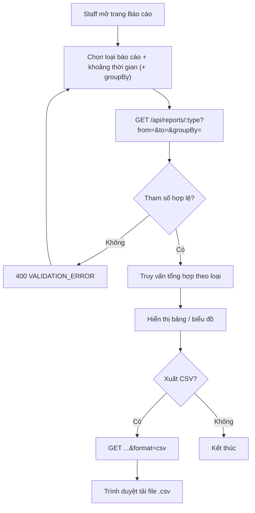

# 2.7.2 Báo cáo chi tiết

## 1. Tổng quan
- **Actor:** Staff (`LIBRARIAN | ADMIN`)
- **Điều kiện tiên quyết:** Đã đăng nhập Staff
- **Kết quả:** Xem 4 loại báo cáo theo khoảng thời gian; xuất CSV.

## 2. Validation rules (query string)
| Tham số | Quy tắc | Nguồn |
|---------|---------|-------|
| `:type` | `books` \| `loans` \| `fines` \| `lost-damaged` | PRD 2.7.2 |
| `from`, `to` | Bắt buộc, `YYYY-MM-DD`, `from ≤ to`, khoảng tối đa 5 năm | PRD 2.7.2 / Giả định (max) |
| `groupBy` | Chỉ cho `loans`: `day` \| `week` \| `month` \| `quarter` \| `year`, mặc định `day` | PRD 2.7.2 |
| `format` | `json` (mặc định) \| `csv` | PRD 2.7.2 |

## 3. Quy tắc nghiệp vụ
- BR-01 Bộ lọc thời gian ở FE gồm preset **Ngày / Tuần / Tháng / Quý / Năm** (hôm nay, tuần này, tháng này, quý này, năm nay — tính theo giờ VN, tuần bắt đầu thứ Hai) và tùy chọn khoảng ngày; FE chuyển thành `from`/`to`. Mặc định: tháng này.
- BR-02 `from`/`to` là ngày VN, bao gồm cả hai đầu: `ts >= from 00:00 VN` và `ts < (to + 1) 00:00 VN`.
- BR-03 **Báo cáo Sách** (`books`): mỗi sách chưa xóa — Tên, Tác giả, Thể loại, Tổng, Có sẵn, Đang mượn, Hư hỏng, Mất (hiện tại), **Số lần mượn trong kỳ** (đơn có `borrow_date` trong kỳ). Dòng tổng ở cuối.
- BR-04 **Báo cáo Mượn Trả** (`loans`): theo từng mốc `groupBy` — Số lượt mượn (đơn có `borrow_date` trong mốc), Số lượt trả (`returned_at` trong mốc). Các mốc không có dữ liệu vẫn hiển thị 0 (`generate_series`). FE vẽ biểu đồ đường/cột Recharts.
- BR-05 **Báo cáo Phạt** (`fines`):
  - Tổng doanh thu phạt = `SUM(amount)` của phiếu `PAID` có `paid_at` trong kỳ, chia theo lý do (`LATE` / `DAMAGED` / `LOST`).
  - Tổng phát sinh trong kỳ = `SUM(amount)` phiếu có `fine_date` trong kỳ.
  - **Người nợ ngoài hạn**: độc giả có phiếu chưa thanh toán (`UNPAID | PENDING | REJECTED`) **hoặc** đơn `OVERDUE` tại thời điểm xem — tên, email, số phiếu nợ, tổng nợ, số đơn quá hạn. (Không phụ thuộc khoảng thời gian.)
- BR-06 **Báo cáo Sách Mất/Hư** (`lost-damaged`): các yêu cầu trả `CONFIRMED` với `condition ∈ {DAMAGED, LOST}` và `confirmed_at` trong kỳ — Ngày, Sách, ISBN, Tình trạng, Độc giả, Ghi chú; kèm bảng tổng hợp theo sách (số bản hư, số bản mất) = danh sách sách cần thay thế.
- BR-07 **CSV**: `Content-Type: text/csv; charset=utf-8`, có BOM UTF-8 (mở bằng Excel không lỗi tiếng Việt), `Content-Disposition: attachment; filename="bao-cao-<type>-<from>-<to>.csv"`. Tiêu đề cột tiếng Việt. Escape `"`, `,`, xuống dòng theo RFC 4180. Báo cáo có nhiều bảng (fines, lost-damaged) → CSV xuất bảng chi tiết chính; thêm `section=debtors|summary` để chọn bảng phụ.
- BR-08 Không phân trang báo cáo (giới hạn an toàn 10.000 dòng).

## 4. Flowchart


## 5. Test cases
### Happy cases
| Mã | Mô tả | Kết quả mong đợi |
|----|-------|------------------|
| HC-01 | `books`, tháng này | Mỗi sách có số lần mượn trong kỳ đúng; dòng tổng khớp dashboard |
| HC-02 | `loans`, `groupBy=day`, 7 ngày | 7 mốc, ngày không có dữ liệu = 0 |
| HC-03 | `loans`, `groupBy=month`, cả năm | 12 mốc |
| HC-04 | `loans`, `groupBy=quarter` | 4 mốc / năm |
| HC-05 | `fines`: 2 phiếu PAID trong kỳ (10.000 LATE, 50.000 DAMAGED) | `revenue.total = 60000`, chia đúng theo lý do |
| HC-06 | `fines`: danh sách người nợ | Có reader có phiếu `REJECTED`; không có reader đã trả hết |
| HC-07 | `lost-damaged` | Chỉ yêu cầu trả DAMAGED/LOST trong kỳ |
| HC-08 | `format=csv` | Header đúng, có BOM, mở Excel hiển thị đúng tiếng Việt |
| HC-09 | Preset "Tuần" vào Chủ nhật | `from` = thứ Hai đầu tuần |
| HC-10 | Admin gọi | 200 |

### Edge cases
| Mã | Mô tả | Kết quả mong đợi |
|----|-------|------------------|
| EC-01 | `from > to` | 400 |
| EC-02 | Thiếu `from`/`to` / sai định dạng | 400 |
| EC-03 | `type=abc` | 404 |
| EC-04 | `groupBy=hour` | 400 |
| EC-05 | Khoảng > 5 năm | 400 |
| EC-06 | Kỳ không có dữ liệu | 200, mảng rỗng / số 0; CSV chỉ có header |
| EC-07 | Phiếu PAID có `paid_at` 23:59 ngày `to` (giờ VN) | Được tính |
| EC-08 | Tên sách chứa dấu phẩy / dấu nháy kép | CSV escape đúng |
| EC-09 | Reader gọi | 403 |

## 6. API
### `GET /api/reports/:type`
- **Quyền:** Staff
- **Query:** `from`, `to`, `groupBy` (loans), `format`, `section` (csv)
- **Response 200 (json)** — ví dụ `loans`:
  ```json
  { "data": { "from": "2026-10-01", "to": "2026-10-31", "groupBy": "day",
              "rows": [ { "period": "2026-10-01", "borrowCount": 3, "returnCount": 1 } ],
              "totals": { "borrowCount": 40, "returnCount": 35 } } }
  ```
  `fines`:
  ```json
  { "data": { "revenue": { "total": 60000, "byReason": { "LATE": 10000, "DAMAGED": 50000, "LOST": 0 } },
              "issued": { "total": 90000, "count": 4 },
              "debtors": [ { "id": "uuid", "name": "...", "email": "...", "unpaidCount": 1, "unpaidTotal": 30000, "overdueCount": 0 } ] } }
  ```
- **Response 200 (csv):** file CSV (BR-07)
- **Lỗi:** `400 VALIDATION_ERROR`, `401`, `403`, `404`

## 7. Giả định / câu hỏi mở
- "Người nợ ngoài hạn" = có phiếu phạt chưa thanh toán hoặc đơn quá hạn (BR-05) — cần xác nhận.
