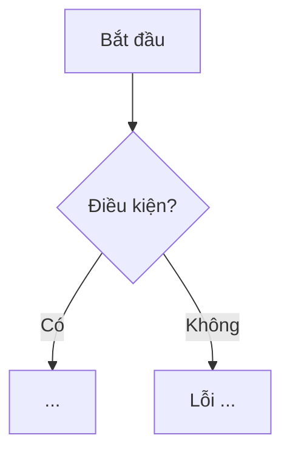

# Luồng nghiệp vụ — Quy ước chung & Template

Mỗi chức năng trong PRD Phần 2 có một file `docs/flows/<mã>-<slug>.md`. Các mã `HC-xx` (happy case) và `EC-xx` (edge case) trong từng file được dùng trực tiếp làm test case ở Stage 3 (unit / API / E2E). Thiết kế DB đi kèm: [`../db-design.md`](../db-design.md).

## Danh sách file

| Mã | File | Actor |
|----|------|-------|
| 2.1.1 | [2.1.1-dang-ky.md](2.1.1-dang-ky.md) | Khách |
| 2.1.2 | [2.1.2-dang-nhap.md](2.1.2-dang-nhap.md) | Khách |
| 2.1.3 | [2.1.3-ho-so-ca-nhan.md](2.1.3-ho-so-ca-nhan.md) | Độc giả |
| 2.2.1 | [2.2.1-quan-ly-the-loai.md](2.2.1-quan-ly-the-loai.md) | Nhân viên |
| 2.2.2 | [2.2.2-them-sach.md](2.2.2-them-sach.md) | Nhân viên |
| 2.2.3 | [2.2.3-danh-sach-sach.md](2.2.3-danh-sach-sach.md) | Tất cả |
| 2.2.4 | [2.2.4-chi-tiet-sach.md](2.2.4-chi-tiet-sach.md) | Tất cả |
| 2.2.5 | [2.2.5-sua-xoa-sach.md](2.2.5-sua-xoa-sach.md) | Nhân viên |
| 2.3.1 | [2.3.1-muon-sach-doc-gia.md](2.3.1-muon-sach-doc-gia.md) | Độc giả |
| 2.3.2 | [2.3.2-xac-nhan-muon-sach.md](2.3.2-xac-nhan-muon-sach.md) | Nhân viên |
| 2.3.3 | [2.3.3-lich-su-muon-gia-han.md](2.3.3-lich-su-muon-gia-han.md) | Độc giả |
| 2.4.1 | [2.4.1-yeu-cau-tra-sach.md](2.4.1-yeu-cau-tra-sach.md) | Độc giả |
| 2.4.2 | [2.4.2-xac-nhan-tra-sach.md](2.4.2-xac-nhan-tra-sach.md) | Nhân viên |
| 2.5.1 | [2.5.1-quan-ly-muc-phat.md](2.5.1-quan-ly-muc-phat.md) | Quản lý viên |
| 2.5.2 | [2.5.2-thanh-toan-phat-doc-gia.md](2.5.2-thanh-toan-phat-doc-gia.md) | Độc giả |
| 2.5.3 | [2.5.3-xac-nhan-thanh-toan-phat.md](2.5.3-xac-nhan-thanh-toan-phat.md) | Nhân viên |
| 2.6.1 | [2.6.1-danh-sach-nguoi-dung.md](2.6.1-danh-sach-nguoi-dung.md) | Quản lý viên |
| 2.6.2 | [2.6.2-gan-vai-tro.md](2.6.2-gan-vai-tro.md) | Quản lý viên |
| 2.7.1 | [2.7.1-dashboard.md](2.7.1-dashboard.md) | Nhân viên, Quản lý viên |
| 2.7.2 | [2.7.2-bao-cao-chi-tiet.md](2.7.2-bao-cao-chi-tiet.md) | Nhân viên, Quản lý viên |

## Quy ước chung (áp dụng cho mọi luồng)

### Phân quyền
- Vai trò: `READER`, `LIBRARIAN`, `ADMIN`.
- `ADMIN` "toàn quyền" (PRD 2.6.2) → mọi endpoint của Nhân viên đều cho phép `LIBRARIAN` **và** `ADMIN`. Ký hiệu trong các file: **Staff** = `LIBRARIAN | ADMIN`.
- Endpoint chỉ dành cho Admin: quản lý mức phạt (2.5.1), quản lý người dùng (2.6.x).
- Endpoint dành cho Độc giả (mượn, trả, thanh toán phạt) chỉ cho `READER`.

### Xác thực
- Header `Authorization: Bearer <JWT>`; JWT hết hạn sau 24h, payload `{ sub: userId, role }`.
- Middleware `auth` **đọc lại user từ DB mỗi request**: không tìm thấy hoặc `is_active = false` → `401`. Như vậy khi Admin vô hiệu hóa hoặc đổi vai trò, thay đổi có hiệu lực ngay, không phải chờ token hết hạn.
- Vai trò lấy từ DB, không lấy từ payload token.

### Định dạng phản hồi
- Thành công: `{ "data": ... }`; danh sách phân trang: `{ "data": [...], "meta": { "page", "limit", "total", "totalPages" } }`.
- Lỗi: `{ "error": { "code": "<MA_LOI>", "message": "<tiếng Việt>", "details": [{ "field", "message" }] } }`.

| HTTP | `code` mặc định | Khi nào |
|------|-----------------|---------|
| 400 | `VALIDATION_ERROR` | Joi validate thất bại (`details` liệt kê từng field, mỗi field tối đa 1 lỗi) |
| 401 | `UNAUTHORIZED` | Thiếu/sai/hết hạn token, tài khoản bị vô hiệu hóa |
| 403 | `FORBIDDEN` | Sai vai trò |
| 404 | `NOT_FOUND` | Không tìm thấy tài nguyên (hoặc tài nguyên của người khác) |
| 409 | mã riêng | Xung đột trạng thái/dữ liệu (trùng email, sai trạng thái đơn...) |
| 422 | mã riêng | Vi phạm quy tắc nghiệp vụ (vượt giới hạn mượn, còn nợ phạt...) |
| 500 | `INTERNAL_ERROR` | Lỗi không mong đợi |

### Thời gian
- Lưu `timestamptz` (UTC). Mọi khái niệm "ngày" (hôm nay, hạn trả, quá hạn, trả muộn) tính theo múi giờ **Asia/Ho_Chi_Minh**.
- "Quá hạn": `today_vn > due_date`. "Trả muộn": ngày xác nhận trả (theo giờ VN) `> due_date`.
- Day.js (`utc`, `timezone`) ở cả FE và BE.

### Phân trang & tìm kiếm
- Query `page` (mặc định 1), `limit` (mặc định 10, tối đa 100). Tìm kiếm không phân biệt hoa thường (`ILIKE`).

### Tiền tệ
- VND, số nguyên, kiểu `numeric(12,0)`.

### Trạng thái "Quá hạn"
- Trạng thái đơn được lưu trong DB. Trước mỗi truy vấn liên quan đến đơn mượn (danh sách, giới hạn mượn, gia hạn, dashboard), service gọi `refreshOverdueLoans()`:
  `UPDATE loans SET status='OVERDUE' WHERE status='BORROWING' AND due_date < (now() AT TIME ZONE 'Asia/Ho_Chi_Minh')::date`.
  Có thể thêm Vercel Cron chạy hằng ngày (không bắt buộc).

---

## Template file luồng

````markdown
# <mã> <Tên chức năng>

## 1. Tổng quan
- **Actor:** ...
- **Điều kiện tiên quyết:** ...
- **Kết quả:** ...

## 2. Validation rules
| Trường | Quy tắc | Nguồn |
|--------|---------|-------|
| ... | ... | PRD x.y.z / Giả định |

## 3. Quy tắc nghiệp vụ
- BR-01 ...

## 4. Flowchart


## 5. Test cases
### Happy cases
| Mã | Mô tả | Kết quả mong đợi |
|----|-------|------------------|
| HC-01 | ... | ... |

### Edge cases
| Mã | Mô tả | Kết quả mong đợi |
|----|-------|------------------|
| EC-01 | ... | ... |

## 6. API
### `METHOD /api/...`
- **Quyền:** ...
- **Request:** ...
- **Response 2xx:** ...
- **Lỗi:** ...

## 7. Giả định / câu hỏi mở
- ...
````
